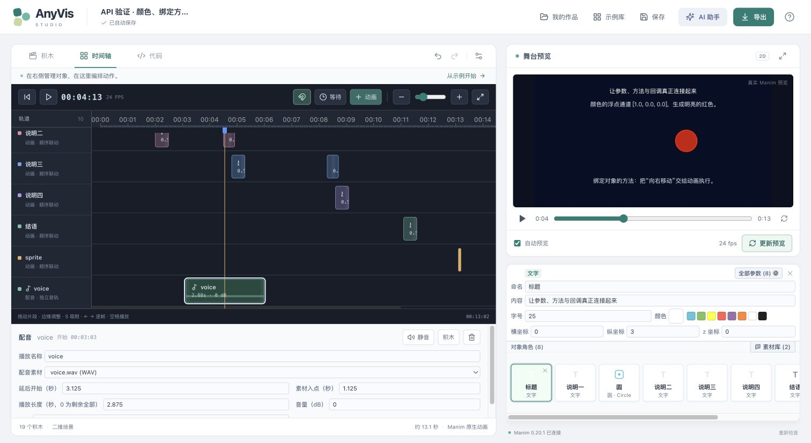

# AnyVis

> **后续修复已完成三轮复验**：[2026-11-09 修复报告](docs/fixes-2026-11-09.md)，623 项应用测试、30 项 API 原生测试及新增 Manim 检查通过；功能限制与完整覆盖缺口仍需明确区分。

> **2026-11-09 独立验收**：[验收报告与修复清单](docs/acceptance-2026-11-09.md)。此前的全覆盖与完成度声明须以独立验收和后续修复复验为准。

**用 Scratch 风格积木与专业视听工作台制作真实 Manim 数学动画。**

AnyVis **v0.5.0** 是专为数学与计算机科学动画创作者打造的现代化套件。融合 Scratch 风格积木、专业级视频剪辑时间轴（NLE）、19 款交互式数理动效工作台、舞台直接操纵标靶与只读 Python 代码生成器。支持图片素材与讲解配音、波形可视化、自动舒缓钢琴配乐、广播级取景标线、全套快捷键与真实 Manim 视频极速导出。浏览器 + 本地服务及 Electron 桌面版（macOS / Windows / Linux）共享完全一致的创作模型。[编辑器设计方案](docs/editor-timeline-design.md) · [开发交接文档](GEMINI_HANDOFF.md)



[下载桌面测试包：macOS / Windows / Linux](docs/verification.md#最新桌面测试包) · [30分钟影片与可编辑工程](examples/geometry-topology/README.md) · [变更日志](CHANGELOG.md)

---

## v0.5.0 里程碑全新特性

### 1. 19 款专业级数理动效工作台 (Interactive Math Playgrounds)
顶部工作台合集支持 Mega Menu 分类检索，提供与 3Blue1Brown 及 Motion Canvas 同等教学直观性的交互工具，通过下述工作台生成工程动作；模拟预览、章节骨架与自定义缓动的限制见 [修复复验记录](docs/fixes-2026-11-09.md)：
- **3B1B 高等数理**：
  - **线性变换矩阵工作台**：仿射网格实时形变、拖拽基向量 $\hat{i}', \hat{j}'$、行列式投影面积与特征值分析。
  - **微积分导数与切线**：双曲线联动、切点拖拽、$\Delta x \to 0$ 极限逼近动画。
  - **黎曼和与定积分**：左/右/中点/梯形 4 种黎曼矩形、精确 Simpson 对比与误差探针。
  - **傅里叶环绕圆级数**：DFT 复傅里叶运动学仿真、手绘闭合曲线、谐波柱状能谱分析。
  - **复变函数共形映射**：解析映射网格形变、局部导数与 $90^\circ$ 保角正交验证。
  - **2D 向量场与流线**：中心差分散度与旋度探针 HUD、RK4 粒子流流动仿真。
  - **公式专属调色器**：LaTeX 公式符号智能分词与 3B1B 专属 8 色降负荷色彩体系。
- **几何拓扑与空间**：
  - **3D 向量运算与外积**：360° 自由三维坐标系、空间对角线加法合成、点乘投影与叉乘平行四边形面积。
  - **3D 参数曲面**：马鞍面、莫比乌斯带、环面等经典曲面透视投影与环境自转。
  - **图论网络与拓扑**：$K_5$、彼得森图、神经网络拓扑、力导向物理自适应布局与 BFS 最短路径。
  - **欧几里得几何画板**：三角形四心（重心/外心/内心/垂心）动态联动、欧拉线 $HG = 2GO$ 恒成立度量。
  - **极坐标与参数曲线**：心脏线、玫瑰线、最速降线动态描迹与切向单位箭头。
  - **概率分布与 CLT**：高斯正态、二项、泊松、指数分布与 68-95-99.7% 经验法则阴影。
- **导演运镜与专业视听**：
  - **运镜导演与动态取景器**：`MovingCameraScene` 多镜头关键帧序列与构图平滑走位。
  - **字幕配音同步工作台**：逐句时序预览与标准 `.srt` 字幕文件双向导入导出。
  - **音频频谱模拟预览**：声波柱、镜像与示波器演示；尚未接入真实音频分析，插入与独立导出暂不可用。
  - **智能对齐与自动布局**：对标 Figma，支持网格矩阵、水平/垂直均分与环形放射排版。
  - **缓动曲线检查器**：三阶贝塞尔曲线交互手柄（支持 Anticipate 蓄力与 Overshoot 冲出回弹）与实时动画测速跑道。
  - **分镜剧本多章节大纲**：自动划分章节、B站/YouTube 时间戳导出与 `self.next_section()` 代码生成。

### 2. 舞台直接操纵与取景系统 (Stage Direct Gizmo & Viewport)
- **直接操纵标靶（Stage Gizmo）**：在预览画布上为选中对象直观叠加十字标靶与坐标投影，直接拖拽平移并自动对齐 Manim 零点。
- **九宫格与快捷色板浮动条**：舞台底部浮动栏集成 9 宫格极速对齐（`UL/UP/UR/LEFT/CENTER/RIGHT/DL/DOWN/DR`）与 3B1B 经典 8 色秒级换色。
- **画布自由缩放与抓手平移（Stage Zoom & Pan）**：HUD 新增缩放控制胶囊（0.5x ~ 2.0x），支持放大后鼠标平移抓手画布与沉浸全屏预览。
- **广播级取景标线**：内置 80% Title Safe、90% Action Safe 广播安全框、三分法则黄金分割线、原点十字准线。
- **画幅与主题一键切换**：16:9 宽屏、9:16 竖屏（短视频）、1:1 方形、4:3 经典画幅与 5 种数学背景主题即时预览。

### 3. 专业剪辑级时间轴 (Timeline NLE Editing)
- **动作语义色彩分类**：入场（翡翠绿 `#10b981`）、变换（蓝宝石 `#3b82f6`）、强调（琥珀金 `#f59e0b`）、退场（玫瑰红 `#f43f5e`）、停顿（石板灰 `#94a3b8`）、配音（青碧 `#14b8a6`）、配乐（香槟金 `#d4b481`）与运镜（星空紫 `#a855f7`），带有 3px 重音与分类标签，并支持“分类色彩/轨道色彩”一键切换。
- **智能节拍与分镜打点**：支持配音停顿、音乐节拍、动作切换与等距 4 种算法自动打点。
- **NLE 热键与时间指示**：光标划过浮动悬停精确时间码与帧序号药丸（`00:03.12 (94F)`）；引入工业标准剪辑热键（`J` 倒退、`K` 暂停/播放、`L` 快进、`,`/`.` 逐帧单步、`0.5x ~ 2.0x` 播放倍速）。
- **音频轨独立静音与波形裁剪**：音频轨道标题处直接提供静音快捷切换，支持入点/长度双向裁剪与剃刀分割。

### 4. 人体工学操作与全键盘流 (Ergonomics & Keyboard Flow)
- **数字字段横向拖拽微调（Scrubbing）**：对标 Blender/Figma，点击拖拽微调把手（`↔`）无级调值；按住 `Shift` 加速 10x，按住 `Alt` 微调 0.1x；输入框支持 `↑`/`↓` 方向键步进。
- **↺ 一键重置默认值**：任一参数偏离默认值时，标签旁自动显露重置按钮，瞬间恢复出厂初值。
- **📋 1-Click 代码复制**：代码视图与 LaTeX 公式检视器均提供一键复制代码与 Toast 提示。
- **全局命令面板（`⌘K` / `Ctrl+K`）与快捷键速查（`?`）**：快速检索创建对象、跳转动作、切换视图（`1`/`2`/`3` 键秒级无缝切换积木/时间轴/代码）。
- **对象管理器即时过滤**：“全部 / 图形 / 文字 / 坐标 / 参数”分类筛选 Tab、实时搜索框与图层（◀ / ▶）层级微调。

---

## 启动

需要 **Node.js 22.18+**、npm，以及安装 Manim 的 Python 环境。本次原生渲染验证使用 **Manim CE 0.20.1 / Cairo / Python 3.12**。

```sh
npm ci
npm run studio
```

macOS 也可以双击 **start-anyvis.command**。启动器会启动引擎和编辑器，并打开 `http://127.0.0.1:5174`。保持启动终端打开，Ctrl+C 结束本次服务。现有 conda `manim` 环境可自动发现；其他环境可显式指定：

```sh
ANYVIS_PYTHON=/path/to/python npm run studio
```

Windows PowerShell 可运行 `scripts/start-studio.ps1`。生产构建运行方式：

```sh
npm run build
npm start
```

生产界面由本地服务提供，地址为 `http://127.0.0.1:4317`。**不要只运行 `npm run dev`**，它只启动前端，不能独立渲染动画。

## 能做什么

- **常用积木 + 全量 API 浏览器**：100 种常用中文积木，加上根据 Manim 0.20.1 实际签名生成的 2,293 个独立 API 积木入口、9,136 个参数字段与 2,765 项常量。常用积木涵盖几何、文字与公式、函数图像、矩阵与图、参数、动态关系、三维物体、相机、动画和顺序 / 同时 / 重复编排。其中 Python 扩展单独标记，不计无代码覆盖。
- **真实 Manim 画面**：Cairo 渲染中显示实际预览帧，完成后可播放和拖动视频；修改后重新渲染，不用 JavaScript 模拟另一套动画。
- **七个可编辑模板**：第一段动画、单位圆与正弦、割线趋近切线、公式推导、矩阵变换、BFS 与三维曲面；全部已经生成原生视频并查看关键帧。安装内置约2 MB真实参考预览，首次打开即可播放；修改后会标记需要重新渲染。
- **创作工作流**：中文搜索、展开高级参数、对象引用、缩放、撤销 / 重做、对象管理、时间轴编排、自动保存、项目导入 / 导出与 Python 导出。
- **可视化参数编辑**：24 种常用颜色、系统任意颜色选择器、矩阵单元格编辑、可搜索的组合成员多选、多行 Python 编辑；坐标系与参数按类型选择，秒和角度等单位显示在输入框后。找不到或未连接的对象保留名称并提示，不偷偷替换。
- **参数动画**：ValueTracker 与动态点、线、曲线、数字和轨迹。普通 Wait 保留视频阅读时间。
- **AI 辅助**：连接自己的兼容 API 服务生成经过校验的原生积木项目；也可复制包含当前项目和积木目录的提示词，使用已有 AI 后导入 JSON。密钥只在会话中使用，不写入作品。
- **渲染作业**：取消、超时、缓存、过期预览标识、错误到积木映射、导出时保持求值帧率。

## 验证与测试保障

```sh
npm test              # 应用及工作台回归；最新数量见修复复验记录
npm run test:desktop  # 运行 11 项桌面宿主与打包隔离测试
npm run test:server   # 运行 6 项服务端多媒体与安全测试
npm run test:render   # 运行真实 Manim 原生渲染集成测试
npm run build         # 前端生产打包校验（无类型或模块错误）
```

- **当前验证**：结果与适用提交见 [修复复验记录](docs/fixes-2026-11-09.md)；构建仍有大分块警告，不宣称零警告。
- **API 行为证据**：清理弱证据后为 **1,538 / 2,293**；Cairo/shared 1,461 / 1,760，OpenGL 对象状态 77 / 533。尚未达到完整 API 覆盖。
- **持续集成（CI）**：GitHub Actions 针对 Linux x64、macOS（Apple Silicon ARM64 & Intel x64）、Windows x64 每次提交与发布全矩阵自动化测试与打包；历史通过不代表当前提交已通过，请以具体运行结果为准。

## 项目结构

| 路径 | 用途 |
| --- | --- |
| `src/studio/` | 主应用界面、时间轴、对象管理器、舞台标靶与 19 款数理工作台 |
| `src/studio/core/` | 项目格式、积木目录、表达式解析、验证与 Manim 代码编译器 |
| `src/studio/blocks/` | Blockly 积木编辑器与双向数据往返 |
| `src/studio/templates/` | 可编辑模板和真实渲染验收记录 |
| `src/studio/ai/` | 模型提示、项目验证与导入 |
| `server/` | 本地服务、独立 Python 渲染 Worker、媒体输出 |
| `desktop/` | Electron 桌面宿主与打包配置 |
| `scripts/` | 一键启动、环境探测与进程守护 |

## 用 AnyVis 制作的半小时影片

《形状不只一种看法：几何与拓扑》采用六章、72个25秒镜头，通过问题、预测、演示、解释和练习逐步展开。所有画面来自原生积木项目，字幕承担讲解，无配音。

- [影片工程与复现命令](examples/geometry-topology/README.md)：六个可直接导入的五分钟章节，以及72个独立镜头。
- [内容设计](docs/geometry-topology-film-plan.md)与[制作验收记录](docs/geometry-topology-production.md)。

本轮实际使用修复了长章节导入时反复同步重绘的问题：Chrome中386块章节从选定文件到步骤可见约566ms，点击嵌套步骤能够展开定位。命名段落默认折叠，保存过的展开状态保留。新增文字最大宽度、分镜批量渲染与缓存复用，并修复强调动画结束后图形未恢复的问题。
