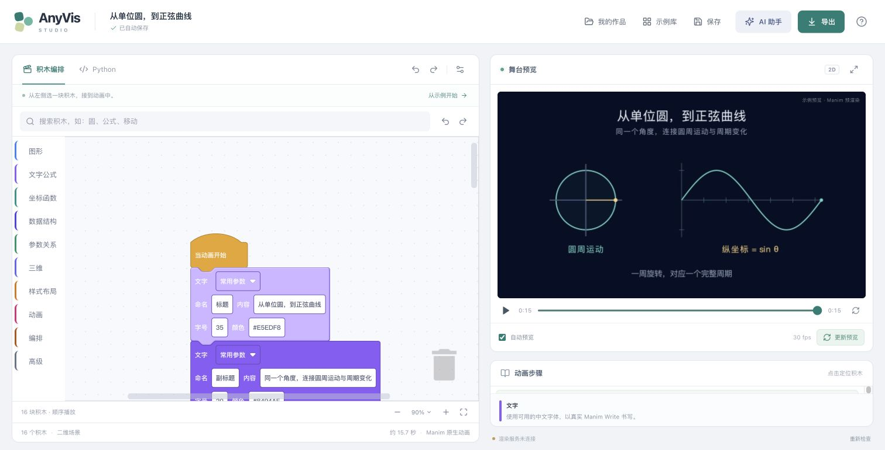

# AnyVis

**用 Scratch 风格积木制作真实 Manim 动画。**

AnyVis v0.2 提供积木创作、原生动画预览、视频与 Python 导出，以及可编辑的 AI 作品导入。当前可运行交付采用本机浏览器界面 + 本地 Manim 服务；正式产品仍以托管运行环境的桌面版为目标。[完整设计方案](docs/AnyVis-Design-v0.2.md)



## 启动

需要 **Node.js 22.18+**、npm，以及安装 Manim 的 Python 环境。本次原生渲染验证使用 **Manim CE 0.20.1 / Cairo / Python 3.12**；并未声称完成 0.22.1 或干净机器安装验收。

```sh
npm ci
npm run studio
```

macOS 也可以双击 **start-anyvis.command**。启动器会启动引擎和编辑器，并打开 `http://127.0.0.1:5174`。保持启动终端打开，Ctrl+C 结束本次服务。现有 conda `manim` 环境可自动发现；其他环境可显式指定：

```sh
ANYVIS_PYTHON=/path/to/python npm run studio
```

Windows PowerShell 可运行 `scripts/start-studio.ps1`。中文文字需要中文字体；公式需要 LaTeX 和 dvisvgm。应用会检查环境，渲染错误可以定位到相关积木。运行时不会修改现有 conda 环境。

生产构建运行方式：

```sh
npm run build
npm start
```

生产界面由本地服务提供，地址为 `http://127.0.0.1:4317`。**不要只运行 `npm run dev`**，它只启动前端，不能独立渲染动画。

## 能做什么

- **78 种积木入口**：几何、文字与公式、函数图像、矩阵与图、参数、动态关系、三维物体、相机、动画和顺序 / 同时 / 重复编排。其中 Python 扩展单独标记，不计无代码覆盖。
- **真实 Manim 画面**：Cairo 渲染中显示实际预览帧，完成后可播放和拖动视频；修改后重新渲染，不用 JavaScript 模拟另一套动画。
- **七个可编辑模板**：第一段动画、单位圆与正弦、割线趋近切线、公式推导、矩阵变换、BFS 与三维曲面；全部已经生成原生视频并查看关键帧。安装内置约2 MB真实参考预览，首次打开即可播放；修改后会标记需要重新渲染。
- **创作工作流**：中文搜索、展开高级参数、对象引用、缩放、撤销 / 重做、步骤定位、自动保存、项目导入 / 导出与 Python 导出。
- **参数动画**：ValueTracker 与动态点、线、曲线、数字和轨迹。没有观众交互暂停节点，普通 Wait 保留视频阅读时间。
- **AI 辅助**：连接自己的兼容 API 服务生成经过校验的原生积木项目；也可复制包含当前项目和积木目录的提示词，使用已有 AI 后导入 JSON。密钥只在会话中使用，不写入作品。未实际调用付费模型验收。
- **渲染作业**：取消、超时、缓存、过期预览标识、错误到积木映射、导出时保持求值帧率。

积木目录不等于 Manim 全 API 覆盖。完整 API、连续帧视频流、任意脚本时间跳转、节点图、可回写时间轴、组件编辑器以及桌面运行时打包仍有后续工作，详见设计与验证记录。

## 第一次使用

1. 打开“示例库”，选择“第一段动画”或“单位圆与正弦”。
2. 点击播放，先观察；在积木中改颜色、文字、时长或参数。
3. 保持自动预览开启，等待真实渲染；需要时可手动更新或取消。
4. 点击右侧步骤定位积木；用“同时执行”或“重复”容器组织动作。
5. 从“导出”保存视频或 `.anyvis.json` 项目。项目文件保留可编辑积木。

## 验证

```sh
npm test
npm run test:server
npm run test:render
npm run build
```

`test:render` 会实际调用本机 Manim 并验证媒体、错误定位和取消；如果未安装 Manim会明确跳过。它使用真实 HTTP handler 的无 socket 适配，不冒充浏览器网络联调。当前工具环境禁止新建监听端口，完整浏览器到新渲染服务的联调需要在正常终端启动后继续验收。[验证记录](docs/verification.md)

## 项目结构

| 路径 | 用途 |
| --- | --- |
| `src/studio/core/` | 项目格式、积木目录、表达式、验证与 Manim 编译 |
| `src/studio/blocks/` | Blockly 编辑与项目往返 |
| `src/studio/templates/` | 可编辑模板和真实渲染验收记录 |
| `src/studio/ai/` | 模型提示、项目验证与导入 |
| `server/` | 本地服务、独立 Python 渲染 Worker、媒体输出 |
| `desktop/` | 可选 Electron 宿主和 AI 服务代理 |
| `scripts/start-studio.*` | 一键启动与进程管理 |

成熟依赖包括 Manim、Blockly、React、Vite 和 CodeMirror。ManimWire 仅作架构研究参考，其含 Commons Clause 的实现未被复制。

原 v0.1 仍可通过 `?legacy=1` 查看，原浏览器草稿没有迁移或覆盖。新版项目采用 schemaVersion 2；旧原型项目需保留原文件，当前不做不完整的自动转换。

桌面宿主需单独安装 Electron，当前未安装或签名验收，不把它称为可直接分发的安装包。参见 [桌面与 AI 接入](desktop/README.md)。按照项目约定，后续成果会持续提交至 GitHub。
