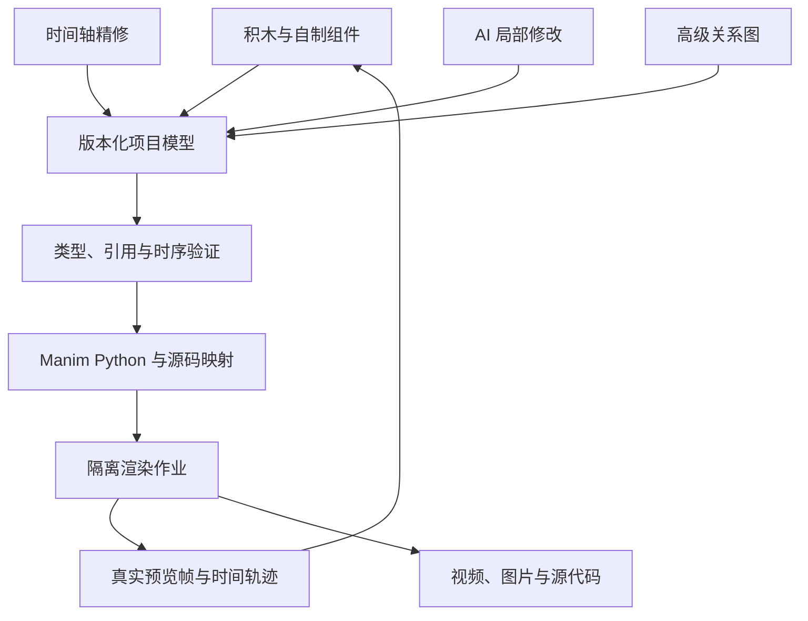

# AnyVis 产品与技术设计方案

版本：v0.2 设计基线 · 日期：2026 年 11 月 7 日  
项目定位：面向零编程基础创作者、支持 AI 协作的 Manim 积木动画制作工具。  
本文状态：设计方案，未宣称以下新功能已经实现。v0.1 原型仅作为可复用代码和交互反例的来源。

## 1. 核心决策

AnyVis 的核心工作流应当是：**选择对象与动画积木 → 拼接讲解过程 → 观看真实 Manim 预览 → 在积木中直接修改 → 导出高质量视频。** 作者也可以先用自然语言让 AI 生成一份可编辑的积木作品，再精确调整。

成品首选 **Electron 桌面应用，内置受管理的 Python / Manim 运行环境**。前端继续采用 React 与 Blockly；浏览器模式保留为开发和未来在线版的复用入口。预览与成片使用同一个 Manim 引擎及明确的渲染器，避免自行模拟 `Write`、`Transform` 等效果。

| 决策 | 具体要求 |
| --- | --- |
| 默认入口 | Scratch 风格积木工作区；新手不必理解节点图或时间轴 |
| 渲染来源 | 真实 Manim；编辑辅助线与选框是独立覆盖层，不进入成片 |
| 时间轴 | 积木编排的可视化视图，可以精修时间，但不维护另一份独立动画逻辑 |
| 节点图 | 高级关系编辑器，按需打开；基础制作不要求连线 |
| 参数 | 用积木在动画中改变数值；滑块仅作为作者调试与试探工具 |
| 交互停顿 | 删除“观众暂停探索—继续”机制；保留普通动画中的 `等待 n 秒` |
| 代码扩展 | 使用 Python / Manim 扩展，代替 v0.1 只能改对象属性的 JavaScript 接口 |
| AI | 操作与用户相同的结构化项目，输出仍可用积木修改；不能只返回一段不透明脚本 |
| 功能覆盖 | 对锁定版本的公共创作 API 逐项登记与验证；代码兜底不计入原生积木覆盖 |
| 交付形态 | 安装后能打开示例并导出视频；普通用户不需要 npm、conda 或命令行 |

这里的“零基础”指不需要 Python、Manim API 或图形学编程基础，不代表不需要理解动画涉及的数学概念。数学输入如 `sin(x)`、矩阵元素和公式是内容；`lambda`、对象生命周期和更新器注册应由界面承担。

## 2. 产品目标与验收方式

### 2.1 最重要的成功标准

1. 没学过 Manim 的用户能在 10 分钟引导后独立制作一个新动画，而不只是播放模板。
2. 基础动画能在积木工作区完成，不要求往返三个编辑器维护同一个逻辑。
3. 典型任务不需要任何自定义代码块；需要代码的边界在文档中明确记录。
4. 预览看见的对象、变形、文字和时间顺序，与最终输出语义一致。
5. AI 生成的作品可以局部修改；换函数、改颜色和改时间不需要整段重写。
6. 复杂功能通过渐进展开获得，不让初学者面对数千个 API 名称。

这些是待测目标，不是已有性能或用户研究结果。最终评价包括完成率、首次出片时间、修改耗时、需要求助的次数、错误率与作品视觉质量。

### 2.2 用户与三条创作路径

| 用户 / 路径 | 起点 | 成功结果 |
| --- | --- | --- |
| 初学者：从零搭建 | 添加圆、写出文字、播放变形 | 不写代码，完成一段有先后顺序的动画 |
| 教师或学生：从组件开始 | 选择切线、向量变换或算法组件 | 替换函数或数据并调整讲解步骤 |
| AI 协作作者 | 描述目标、风格和时长 | 获得可编辑积木初稿，再选中局部精修 |
| 熟练作者 | 完整积木库与自制积木 | 访问高级 Manim 能力，复用已有构造 |

首批验收任务固定为：圆变方形、带文字标注的单位圆与正弦曲线、割线逼近切线、矩阵变换、BFS、三维曲面与相机运动。每个任务都要包含“做出来”之后的修改任务。

## 3. 调研结论与借鉴边界

本次已查看正在 Chrome 中运行的 AnyVis v0.1；它默认展示对象列表、参数检查器、预览和时间轴，积木藏在次级标签页，并且画面由 SVG / Three.js 自行绘制。这与新的核心目标存在结构性差异，不能仅通过换颜色或增加几块积木纠正。

### 3.1 ManimWire

核对版本为提交 `0b6a2e5cb788e51064bd05d9b40a33c4d8d8ce52`。本次依据源码、内置项目和作者测试记录，未安装运行 ManimWire，故不把其性能报告写成本次实测。

| 观察到的实现 | AnyVis 的设计启示 |
| --- | --- |
| Electron / React 前端，Python 引擎生成并运行 Manim | 前端负责编辑，Manim 负责动画语义与画面 |
| API 目录自动发现，并对继承、参数转发等做人工修正 | 广泛覆盖需要机器清单与人工语义适配结合 |
| Python 行号映射回节点 / 步骤 | 错误应定位到具体积木和字段 |
| 保留真实 Scene 执行，逐帧交付与有界缓存 | 可以提前看到画面，无须总是等完整 MP4 |
| 向前恢复执行；无缓存的向后跳转仍可能重算 | 不承诺任意脚本任意时间立即响应 |
| 单位圆示例包含 25 节点、20 连线、5 步骤 | 高表达能力仍需更适合新手的语义封装 |

其输入审计列出 216 类、963 方法、122 函数和 22 内建项，但作者明确区分“已暴露参数”与“全功能行为一致”。AnyVis 采用同样的诚实边界，并将公共 API 总清单作为覆盖率分母。[S01–S05]

**复用决定：参考架构，独立实现核心。** ManimWire 的 LICENSE 包含 Commons Clause 附加条件，不能按纯 Apache-2.0 无限制依赖处理。本方案不复制其源代码或派生产品；如未来选择 fork，需要单独评估该许可与发行目标。Manim 本身的许可与 ManimWire 应分别处理。[S06]

### 3.2 其他项目

| 项目 | 本次核对的事实 | 借鉴方向 |
| --- | --- | --- |
| Manim Blocks | README 列出 Blockly、200+ 积木、自制积木及代码导入；复杂案例仍包含代码入口 | 工具箱搜索、自制积木；不能把代码框算作新手易用性成果 |
| ManimLabs | 官方文档明确区分浏览器近似画面与原生 Manim 成片 | 模板、引导与 AI 编辑流程；AnyVis 要减少两套画面语义的偏差 |
| Blockly | 成熟的积木连接、字段、序列化、撤销基础 | 复用编辑交互，把研发放在领域语义与运行正确性上 |

这些项目的介绍不是完成度证明。后续可用相同任务安装实测，记录冷启动、修改反馈和出片结果，不能仅依据官网判定谁“更成熟”。[S07–S09]

## 4. 桌面版与网页版选择

### 4.1 方案比较

| 方案 | 新手初次使用 | Manim 兼容与预览 | 成本与维护 | 决策 |
| --- | --- | --- | --- | --- |
| 纯浏览器 / WASM | 无安装 | 原生 Python 依赖、公式链和扩展需要移植验证 | 会引入另一套运行平台 | 不作为完整首发目标 |
| 浏览器 + 本地 Python 服务 | 浏览器容易打开，但环境与后台服务易出错 | 可运行真正 Manim | 开发快，正式安装仍需管理器 | 开发模式 |
| 浏览器 + 云渲染 | 用户无需安装 | 可运行 Manim，但反馈受网络、队列影响 | 算力、存储、账户和脚本隔离持续支出 | 后续可选在线版 |
| Electron + Python | 一个安装包，启动即用 | 本地 Manim，可统一 Chromium 编辑界面 | 通常有更高的壳体积 / 内存开销，完整包需实测 | 首选正式成品 |
| Tauri + Python | 也可做一个安装包 | 原生引擎相同；系统 WebView 需跨平台验证 | 空壳通常更轻，完整包需实测；需 Rust / WebView 维护 | 有条件备选 |

Electron 的选择基于现有 React 技术栈、统一的前端运行环境和本地进程管理，并非声称它渲染 Manim 更快。Tauri 在 macOS 使用 WebKit、Windows 使用 WebView2；Blockly、中文输入、视频播放和高 DPI 都需要验证。包含 Python、字体和公式工具链后，完整包大小不能用空壳大小代表。[S10–S13]

### 4.2 成品安装要求

- macOS ARM64 与 Windows x64 为首批发布目标，Linux 排在其后。
- 应用管理私有、固定版本的 Python 环境；不修改用户已有 conda 环境。
- 基础运行时、图形原生依赖、中英文字体和常用公式能力随发行方案交付。
- LaTeX / dvisvgm 的体积、所需宏包、再分发与离线安装必须在打包实验中验证；不能要求普通用户自行解决报错。
- 默认安装提供常用 LaTeX、dvisvgm 与中英文字体，让首个 MathTex 和中文示例无需终端即可成功；高级宏包按需受控安装，另提供完整离线公式包。若基础公式尚需用户自行配置，不能通过“新手开箱可用”验收。
- Typst 可作为支持版本下的额外公式方式，不能代替 LaTeX 后宣称 MathTex / Tex 完全兼容。
- 正式发行要求 macOS 签名与公证、Windows 签名安装器、更新包验证和失败回滚；签名不等于保证消除所有系统信誉提示。必须在没有 Node/Python/conda 的干净机器验证首次出片。
- 现有 conda 环境仅是开发 / 高级选项；应用检测版本后决定是否兼容。
- Manim 0.19 起基础视频链使用 PyAV，不能沿用“必须另装 ffmpeg 命令行”的旧说明；额外音视频处理若引入外部 FFmpeg，另行列为依赖。[S14–S16]

打包前做一次同前端、同 Python Worker 的 Electron / Tauri 小型对照实验，记录安装包体积、闲置内存、中文输入、Blockly 拖放、预览传输、原生文件选择与干净机器首次出片。除非结果明显推翻上述判断，按 Electron 继续，不同时维护两套正式客户端。

## 5. 默认界面与渐进式复杂度

### 5.1 默认只突出三个区域

| 区域 | 内容 | 默认行为 |
| --- | --- | --- |
| 左侧积木库 | 搜索、常用分类、最近使用、组件 | 约 15% 宽；分类切换时显示缩略效果和简短说明 |
| 中间搭建区 | 一条清晰的场景脚本、折叠步骤、自制积木 | 约 45% 宽；允许点击添加、拖动、复制和键盘搜索 |
| 右侧舞台 | 真实 Manim 画面、播放 / 停止、进度、导出 | 约 40% 宽；可一键放大 |

对象清单折叠在舞台下方；选中积木后显示就近字段编辑器。时间轴和节点关系图默认收起。AI 是侧栏或命令输入框，默认不挤占整个编辑区。

“二维 / 三维”是新建时的模板选择，决定初始相机与推荐积木，不是两套无法互通的文件格式。初学者默认二维；使用三维物体时明确提示相机与场景切换，并保留已有对象。

### 5.2 交互原则

- 搜索支持“写出来”“变成”“描边”“切线”等中文含义，也识别 `Write`、`Transform` 等原名。
- 每个积木只默认展示最常用的 1–4 个字段；“更多选项”包含完整高级参数。
- 颜色、字体、对齐、方向、对象引用、点坐标、列表、矩阵分别使用合适控件。
- 对象引用是带名称与缩略图的标签，不要求用户手写变量名。
- 选择画面中的对象可定位创建它的积木；选积木可高亮相关对象，但高亮不进入成片。
- 拖动位置后把修改写回相应属性 / 定位积木；若位置由关系驱动，提示修改关系，不能静默断开绑定。
- 静态摆放默认修改初始布局；录制模式开启后才写入动画，避免拖一下就意外生成关键帧。
- 所有操作可撤销。错误就近显示，默认用中文解释；Python traceback 放在可展开详情。
- 提供键盘添加、放大、搜索与高对比状态，不仅依赖颜色和拖动。

## 6. 积木模型

### 6.1 三层积木库

| 层级 | 面向用户 | 内容 | 计入覆盖的方式 |
| --- | --- | --- | --- |
| 常用语义积木 | 初学者 | 创建圆、写公式、将对象变成另一个对象、沿路径运动 | 对应 API 的常用任务直接无代码完成 |
| 完整 Manim 积木 | 熟练作者 | 按对象类型展开构造器、方法、函数及全部支持参数 | 每项 API 有明确类型端口和行为测试 |
| 自制组件与扩展 | 复用者 / AI / 开发者 | 参数化积木、组合构造、函数、Python 扩展 | 扩展覆盖独立报告，不充当原生覆盖 |

完整积木不全部放在默认工具箱。选择一个对象后展示它适用的操作，继承方法在目录中去重、在实际类型上可用。自动生成的 API 表单只是起点，必须补默认值、参数解释和示例。

### 6.2 积木语法与语义

| 形态 | 例子 | 执行语义 |
| --- | --- | --- |
| 起始块 | 当动画开始；创建场景 | 定义一个场景，不创建观众交互事件 |
| 对象值块 | 圆、公式、坐标系、曲面 | 返回稳定对象引用，可嵌入创建声明 |
| 命令块 | 将圆放到右侧；设置填充 | 在当前位置立即修改场景 / 对象 |
| 动画块 | 用 1 秒画出圆；用 2 秒移动 | 产生有时长的 Manim 动画 |
| 容器块 | 同时；依次；逐个；重复；对每项 | 包含可折叠的子动作 |
| 值 / 表达式块 | 数字、颜色、向量、函数、参数 | 返回有类型的值 |
| 关系块 | 标签跟随点；点位于曲线上 | 注册受管理的持续关系 / updater |
| 函数 / 自制积木 | 输入半径，输出构造或步骤 | 有显式输入、输出、局部作用域 |

用户的基础动作可以是“画一个圆”，一次创建对象并播放 `Create`。展开后可以分别编辑“构造圆”与“显示圆”，从而兼顾易学与精确生命周期。

### 6.3 最小创作示例

| 顺序 | 用户看到的积木 | 默认字段 / 结果 |
| --- | --- | --- |
| 1 | 当动画开始 | 16:9 深色画布 |
| 2 | 用 1 秒画出一个圆，命名为“圆 A” | 默认半径、颜色和居中位置 |
| 3 | 将“圆 A”变成一个正方形，用时 1.5 秒 | 明确保持 A 的身份，目标仅作形状模板 |
| 4 | 在下方写出“形状在变化”，用时 1 秒 | 正文中文字体与合理间距 |
| 5 | 等待 1 秒 | 给观众阅读时间，自动继续 |

基础路径不应出现 `self.add`、`lambda` 或对象生命周期术语。高级属性中仍能明确选择 `Transform`、`ReplacementTransform`、`TransformFromCopy` 等不同身份语义。

### 6.4 复杂动画的封装

“割线逼近切线”组件接受函数、点位置、割线间距与动画时长，输出坐标系、曲线、点、线、标签等具名端口。用户可以改参数，也可以展开内部积木；AI 能编辑内部局部，然后重新折叠。组件是带版本的普通项目结构，不是编辑器里的黑箱视频。

参数变化块如“把 a 从 0.5 变到 2，用 3 秒”，负责让观众看到参数影响。作者拖动滑块只改变试看的参数；选择“写入动画”或“设为初值”后才成为作品的一部分。

## 7. 完整 Manim 覆盖策略

### 7.1 定义“全部”

目标是**锁定版 Manim Community Edition 的公共场景创作能力**，包括构造器、对象方法、动画、场景 / 相机、函数、配置、更新器和公开辅助类型。私有实现、测试工具、日志内部接口不是创作积木；所有排除项必须逐项记录理由，不能为了提高覆盖率随意缩小分母。

交互调试 API（如 interactive_embed、鼠标事件）归入高级调试能力并单独记录，不做观众暂停节点；有时限的 wait_until 仍属高级时序控制。

不把 ManimGL 和 Manim CE 混称为同一 API；第三方插件有独立版本与覆盖清单。自定义 Python 子类、函数与外部库通过高级视觉函数 / 类型构造或扩展接口接入；不能声称有限的一套预设块已经覆盖任意 Python 程序。

本机实测为 **Manim CE 0.20.1 / Python 3.12**。本次枚举该安装包发现顶层可访问、且来源模块属于 Manim 的 254 个公开类名（253 个不同类对象）、146 个函数名，以及去除继承重复后 1,064 个类自身公共可调用成员 / 属性。这个计数是明确过滤口径下的库存，不等于完整公共创作 API 的最终分母，也不等于功能已实现。原始清单见 `research/manim-ce-0.20.1-inventory.json`。

官网 stable 本次标识 **0.22.1**，存在本机没有的接口。现有 0.20.1 仅用于 P0 探索实验；正式 v1 目标基线定为 0.22.1，P1 的编译 / 预览协议实现开始前就建立并验证独立环境、锁文件和新清单，避免先依赖旧版内部 API 再迁移。旧项目记录原版本，不能静默按新版解释。[S17]

### 7.2 功能族矩阵

下表是验收分类与入口设计，API 名称是代表项，不冒充完整枚举；最终完整列表由指定版本的扫描、文档核对和人工审核共同生成。

| 功能族 | 代表能力 / API | 积木或控件设计 | 关键验收 |
| --- | --- | --- | --- |
| 场景与生命周期 | Scene、add/remove/clear、层级与 sections | 开始、添加、移除、置顶、分段 | 创建 / 显示 / 移除分离，引用不丢失 |
| 基础对象 | Mobject、VMobject、VGroup、Group、点云对象 | 对象、组合、子对象选择 | 复制与共享引用不同，家族样式正确 |
| 二维几何 | 线、点、圆、弧、多边形、箭头、布尔操作 | 图形库、路径与顶点编辑器 | 边界、箭头端点、布尔结果可动画 |
| 文本 | Text、MarkupText、Paragraph、Code | 文本输入、字体、样式、代码高亮控件 | 中文字体、换行、分词 / 分字选择 |
| 公式 | Tex、MathTex、模板、局部选择和配色 | 公式编辑器、符号片段标签 | 编译错误定位；公式片段身份稳定 |
| 新版公式方式 | 基线支持的 Typst / MathTypst 等 | 独立公式类型与语法提示 | 不将 Typst 语法误当 LaTeX |
| 数值显示 | DecimalNumber、Integer、Variable、ValueTracker | 参数、计数器、格式与精度 | 小数位、单位、动态刷新与显示宽度 |
| 坐标系 | Axes、NumberPlane、NumberLine、ComplexPlane、PolarPlane | 范围 / 刻度面板、坐标值块 | 数学坐标与舞台坐标显式转换 |
| 函数与微积分 | plot、ParametricFunction、面积、割线、黎曼和 | 数学表达式、区间、采样 / 间断点选项 | 不连续函数不连错线；定义域正确 |
| 数据与结构 | Matrix、Table、Graph、DiGraph、BarChart | 矩阵 / 表格编辑、图节点与边 | 单元格、节点、边可独立选择与动画 |
| 三维几何 | 球、立方体、圆柱、锥、Surface、ThreeDAxes | 立体 / 参数曲面、参数区间 | 相机、法线、透明、深度与遮挡 |
| 向量场 / 流线 | ArrowVectorField、StreamLines | 向量函数、区域与密度 | 采样量限制、播放语义、性能提示 |
| 样式与布局 | set_color/fill/stroke、next_to、align_to、arrange | 颜色、相对位置、对齐、分布 | 缩放后线宽、组布局与文本间距 |
| 几何操作 | shift、move_to、scale、rotate、apply_matrix | 位置 / 角度 / 矩阵值控件 | 角度单位显式；变换中心可选 |
| 入场 / 退场 | Create、Write、Uncreate、FadeIn/Out、Grow | 效果预览卡片 | 使用真实路径 / 字形动画 |
| 形变 | Transform、ReplacementTransform、TransformFromCopy | 形变方式与身份说明 | 后续引用、对象集合与匹配结果正确 |
| 公式 / 图形匹配 | TransformMatchingTex / Shapes 等 | 自动匹配 + 手动对应关系 | 重复符号、未匹配部分、碎片选择 |
| 强调 | Indicate、Flash、Circumscribe、Wiggle 等 | 强调效果块 | 效果结束后样式恢复正确 |
| 运动 / 同伦 | MoveAlongPath、Homotopy、PhaseFlow 等 | 路径引用、数学函数 / 函数块 | 参数、时间、目标类型和积分行为 |
| 动画组合 | AnimationGroup、Succession、LaggedStart、Map | 同时 / 依次 / 逐个 / 对每项 | 重叠、延迟比例、嵌套时长正确 |
| 动画属性链 | `.animate`、target、save_state / restore | 在同一动画内“移动并旋转并缩放” | 同对象变换合成，避免动画互相覆盖 |
| 速度与时序 | rate_functions、run_time、lag_ratio、ChangeSpeed | 缓动曲线选择 / 可视化、速度曲线 | 帧率变化不改变预定总时长 |
| 更新器与依赖 | add_updater、always_redraw、dt / alpha 更新 | 保持关系、每帧执行、开启 / 暂停 / 清除 | dt 顺序、对象身份、结束时清理 |
| 轨迹与历史 | TracedPath、状态化更新 | 轨迹块与采样参数 | 跳转不丢历史，未缓存回退正确 |
| 相机 | MovingCameraScene、ThreeDScene、ZoomedScene | 镜头移动 / 缩放 / 旋转 / 放大窗 | 固定在屏幕的标注与世界对象区分 |
| 图片与资源 | SVG、ImageMobject、资源路径 | 文件选择、缩略图、资源库 | 便携打包、缺失资产提示 |
| 音频、字幕与输出 | add_sound、subcaption、格式 / 质量 / 透明 | 音轨与字幕面板、导出预设 | 音画同步、格式支持与依赖正确 |
| 编程与扩展类型 | 条件、循环、列表、字典、函数、类引用、模板对象 | 高级视觉编程和结构化类型编辑 | 非 JSON Python 对象可通过引用构造 |

### 7.3 覆盖率不能只用一个数字

每个条目分别记录以下状态：

- `discovered`：已找到接口及来源版本。
- `block_available`：有原生可连接的积木入口。
- `inputs_constructible`：所需参数值能在视觉系统中构造；未知 `kwargs` 不自动算完成。
- `render_verified`：代表场景实际渲染通过。
- `behavior_verified`：对象身份、时序与副作用与参考 Python 相符。
- `renderer_support`：Cairo / OpenGL 各自结果。
- `novice_task_verified`：对应常见任务无需代码，且通过用户测试。

代码扩展记为 `extension_only`，不计为 `block_available`。尚未完成条目公开标记，不用“完整支持”覆盖掉它们。v1 的广覆盖验收要求：全部纳入范围的 API 有原生入口；必要参数可构造；每个条目至少有一个适当的可执行行为用例；有视觉输出的 API 另有渲染对照，纯函数 / 配置 / 资源操作使用对应行为测试；重要边界有专门用例。所有参数组合的穷尽测试并不可行，因此不能把这个验收叫数学意义上的行为等价证明。

## 8. 类型系统、对象身份与作用域

基础值类型包括 Number、Boolean、String、Color、Angle、Vector2/3、Matrix、List<T>、Map、MathExpression、Function、MobjectRef、Animation、CameraRef、AssetRef、ClassRef、Config、SceneRef。端口类型采用可扩展 schema；动态返回值可附运行时验证。

对象使用稳定内部 ID。用户修改“圆 A”的显示名称不会破坏引用；复制创建新 ID，引用同一对象不自动复制。组的共享子对象、变形的目标和变形后的对象身份必须明确建模。

普通脚本按顺序执行。关系表达式构成单独依赖图，使用拓扑排序及环检测；命令顺序与关系依赖不能混成一张图。每个自制积木有局部作用域，参数默认按值或只读引用传入；需要修改外部对象时在端口中标识。循环变量和子对象选择器具备明确作用域。

动态对象数量、拓扑变化、每帧创建对象不是简单属性绑定。提供高级“重新生成构造”块，标记缓存失效与性能影响；不能假定静态 Repeat 的数量在运行时可任意变化。

## 9. 一个项目模型，多种编辑视图

项目的权威数据是带类型的领域中间表示（IR）。Blockly 的坐标、折叠和选中状态是编辑元数据；不能把 Blockly 生成的 Python 文本作为唯一保存格式。节点图、时间轴和 AI 都通过同一组受校验命令更新 IR。

主要结构包括 Project、Scene、ObjectDefinition、Expression、Action、Relationship、ComponentDefinition、Asset、RuntimeLock。Action 支持 Sequence、Parallel、Stagger、Wait、Animate、Add/Remove、Loop、Conditional、CallComponent、UpdaterScope 与受信任 Extension。

先实现 **IR → 积木视图 / Python** 的可追踪映射，以及编辑积木的 IR 命令。任意 Python 反编译为原生积木不是首版承诺：已知模式可以导入；其余放入明确标记的代码片段，不能冒充可视化转换成功。

## 10. 时间轴与执行语义

积木顺序是新手理解时间的主要方式。“同时执行”包含并行分支，“逐个执行”表达错开入场，“等待”占用普通播放时长。

时间轴展示这些动作的实际开始、结束与分组。拖动时长可回写对应积木；调整开始时间通过明确的等待 / 组内偏移表达。若拖动不能唯一映射，界面提供“移动整个步骤”或“加入等待”，不静默重排语义。

带条件、运行期循环和任意 Python 的段落，时间轴先显示执行轨迹。只有能够安全回写的字段可编辑；其余标为动态段落。对任意程序承诺可随意拖动全部片段，会造成时间轴与代码双重真相。

并行处理必须生成真正的 AnimationGroup / Succession / 相应组合，不能把按起点排序的动画逐个写成阻塞 `self.play`。同对象同时修改多个属性优先合成一个 `.animate` 链；无法证明兼容的重叠给出冲突提示，而非默认任意动画都能叠加。

角度输入可选择度或弧度，内部统一。数学坐标、场景坐标、屏幕像素分别有类型。随机数采用项目种子；帧率、渲染器和运行时锁定，以便复现。

## 11. 真实预览与响应设计

### 11.1 预览等级

| 状态 | 实际行为 | 界面说明 |
| --- | --- | --- |
| 编辑反馈 | 积木连接、布局框与属性立即响应 | 不把辅助反馈伪装成已渲染画面 |
| 静态首帧 | 对当前有效版本请求真实 Manim 图像 | 显示“预览更新中”直至新帧完成 |
| 连续预览 | 低分辨率、逐帧输出并播放 | 渲染落后时缓冲，保留正确顺序 |
| 缓存跳转 | 当前版本目标帧命中缓存 | 直接显示正确缓存帧 |
| 冷跳转 / 修改后跳转 | 恢复执行或重算必要历史 | 可取消、有进度，不声称零延迟 |
| 成片 | 使用同一项目和渲染器的高质量作业 | 明确分辨率、帧率与版本 |

首期以 Cairo 正确性为参考实现，完成对象 / 动画的一致性后再加入 OpenGL 加速适配。每个项目固定所用渲染器；切换必须重新预览并失效缓存。OpenGL 不兼容的场景不能静默换渲染器后交付不同画面。

ManimWire 的连续执行与缓存说明此路线可行，但其测量有特定硬件、场景和缓存条件，不能直接成为 AnyVis 的承诺。[S03–S04]

选择积木时，舞台默认显示清楚标注的“当前步骤末态”，便于摆放刚创建的对象；这不是时间零的播放帧。开始播放或拖动播放头后切回真实时间状态。未来才创建的对象在布局预览中可见，不能因此提前加入真实播放。

项目先确定最终求值帧率。预览优先只降低分辨率，或按同一求值步长计算后抽帧显示；不能为了提速随意把 60 fps 的状态化 updater 改为 30 fps 计算后仍声称完全一致。若用户选择低步长成本的近似预览，必须标明近似，导出前提供最终帧率验证。

### 11.2 实现约束

- 渲染放在独立工作进程；配置、patch 与 OpenGL 上下文按执行隔离。
- 前端发送 `projectRevision / sceneId / targetTime / renderProfile / requestId`，旧版本返回帧不得覆盖新版本。
- 修改去抖、任务取消、最新目标优先；停止必须能在 Worker 无响应时终止进程并恢复。
- 首期缓存整段编译语义哈希，保守失效；确认依赖分析正确后，再从最早受影响动作开始复用。
- 文本 / 公式 / 资源缓存与帧缓存分层；键包含引擎版本、渲染器、字体、资产、随机种子和质量配置。
- 不使用每帧 Base64 JSON；采用有界二进制传输和背压。以 960×540 RGBA、30 fps 计算，未压缩像素约 62.2 MB/s，必须测量端到端成本。
- 有状态 updater、轨迹和模拟不能简单用 `F(t)` 替代。向前保留执行，向后先查帧缓存，未命中则重算；只有注册为纯函数的构造才做直接时间求值。
- 不假定 Python 闭包、原生资源和 Scene 可以任意序列化成检查点。检查点恢复是独立优化研究，不是正确性的前提。

### 11.3 首轮性能目标

在本机 Mac 与一台 Windows 参考机上，固定 960×540 / 30 fps 的基础验收场景，分别记录冷启动与热缓存。目标为：编辑器操作 p95 < 50 ms；缓存帧跳转 p95 < 100 ms；简单参数修改后的正确首帧 p95 < 500 ms；热启动简单场景首帧 < 1 s。冷公式编译、复杂曲面、状态化长跳转另行报告。这些目标需要实验校准，不能作为全场景实时保证。

## 12. AI 协作设计

AI 的输出应是受 schema 限制的项目修改，不是直接覆盖整个工程。用户选中一个对象、步骤或组件时，选择范围自动成为 AI 的默认编辑范围。

### 12.1 AI 可用接口

| 接口 | 目的 |
| --- | --- |
| search_blocks / describe_block | 查询当前引擎真实支持的积木与参数 |
| inspect_project / inspect_selection | 获取结构、对象关系和当前选区 |
| propose_patch / validate_patch | 生成并验证对 IR 的局部修改 |
| apply_patch | 原子应用修改，进入同一个撤销栈 |
| render_preview / get_keyframes | 运行真实 Manim，观察结果 |
| get_diagnostics | 读取积木级错误与资源问题 |
| create_component | 将成功片段保存为参数化自制积木 |

每个 patch 带基础 revision、修改范围与预期影响。过期修改拒绝或显式合并；不能覆盖用户刚刚完成的拖动。普通修改可以直接应用并撤销，新增脚本、插件或外部数据访问需要单独处理信任边界。

### 12.2 生成与修复循环

用户描述 → 检索适用组件 → 生成 IR → 静态验证 → 低清渲染 → 检查代表帧 / 错误 → 有限次数局部修复 → 显示结果与修改摘要。初始默认最多自动修复 3 次、每次预览作业 60 秒；均可在高级设置中调整。用户随时可以取消，预算耗尽保留当前最佳有效版本。面板显示已用调用量、可获得的费用估计与用户设置的额度上限，避免无限等待或不可控调用费用。

例如“把最后的圆改为椭圆，前面的讲解保持原样”，应当只修改相关构造及必要依赖。不能只满足能运行，还要验证公式内容、标签、遮挡、镜头和节奏。

### 12.3 接入方式

P1 提供项目 schema、积木目录和导入 / 导出，允许外部 AI 生成项目作为技术验证。P2 就必须打通一个内置 AI 面板的完整流程；首发采用自带 API 密钥（BYOK），提供图形化配置向导和服务连接测试，并保留已有本地 AI 代理连接入口。P3 再扩充模型适配与复杂修改，不把 AI 一直推迟到产品尾声。本地搭积木和 Manim 渲染不需要模型账号；远端模型调用可能收费，不能假定已有聊天产品订阅与 API 额度通用。AnyVis 不自动开通付费服务。密钥保存在系统凭据存储，不写入项目包；远端只发送用户授权的作品内容、选区与必要预览，不默认上传全部本地文件。

“AI 让制作更快”通过和 AI 直接写 Manim 的同任务实验验证。比较首次生成之后的改函数、加标注、局部延时与纠错，不只统计第一稿生成时间。

## 13. 视觉质量与默认行为

真正使用 Manim 解决的是渲染能力，精美作品仍需设计。AnyVis 提供统一主题：背景、前景、强调色、中英文字体、字号层级、线宽、边距、公式比例和默认缓动。对象根据内容密度采用合理初值，不把全部对象默认为同一位置。

组件内置对齐、留白、说明文字和讲解节奏；预览内只显示作品内容，实验编号、编辑器标题和选择标记不能自动进入成片。提供安全边界、标签遮挡提示和画面外对象提示。自动布局的修改要可见、可撤销，避免持续重排打乱作者精修。

模板必须可修改与展开。以“单位圆”模板为例，替换半径、函数、颜色或时长后仍能运行，才算可复用组件，而非固定演示。

## 14. 代码、插件与安全边界

高级用户可以定义带类型输入输出的 Python 自制积木。优先允许函数体或构造工厂，声明所需 Manim 版本、资源和第三方依赖；输出可以是 Mobject、Animation、数值、函数或复合结构，不局限于五个数值属性。

普通积木只生成经过验证的语法，不拼接未处理字符串。Python 扩展运行在作业进程，但进程隔离并不等于恶意代码安全沙箱：本地扩展具有用户授予的本机能力。导入陌生作品默认不运行代码或自动安装插件；启用前给出实际权限与来源。

Electron renderer 禁用 Node 集成，启用上下文隔离与沙箱，通过窄 IPC 暴露打开、保存、渲染、取消等操作。本地开发服务仅监听 loopback，检查来源与每次会话令牌；不能向任意网页开放“执行 Python”接口。云端如开放任意代码，必须使用真正独立的作业隔离和资源配额，不能复用本机进程模型冒充多租户安全。[S11]

## 15. 文件格式、版本与迁移

`.anyvis` 为可携带项目包，包含项目 IR、编辑元数据、资产、字体 / 公式依赖清单、组件版本和运行时锁。缓存是可删除的附属内容，成片与预览不充当唯一源文件。资源使用项目内逻辑引用，防止绝对路径让作品换电脑就失效。

保存采用原子写入与版本备份；崩溃恢复可读取最近有效快照。自动保存、手动保存、另存为和导出分别有清楚语义。导出支持 `.py + assets`，用户可以脱离 AnyVis 运行；同时保留原项目，不能因为改了导出 Python 就覆盖原积木。

旧 v0.1 文件先备份再转换：几何对象、参数和简单时间片段映射到新 IR；交互 cue 不进入新播放流程，迁移记录解释其已移除；原有 Wait 若存在仍保留。JavaScript 扩展不自动翻译成 Python；保留源内容并明确标记未迁移。无法对应的关系给出逐项报告，不能悄悄丢失。

## 16. 软件模块与成熟库复用

| 模块 | 主要职责 | 选用方向 |
| --- | --- | --- |
| 桌面宿主 | 窗口、文件、进程、更新、系统密钥 | Electron + 成熟打包工具 |
| UI | 工作区、导航、属性、预览 | React + TypeScript |
| 积木编辑 | 拖放、连接、字段、序列化、键盘操作 | Blockly，优先采用成熟渲染器与插件 |
| 关系图 | 高级依赖查看 / 编辑 | React Flow；默认不加载 |
| 代码编辑 | Python 语法、诊断、定位 | CodeMirror，后续评估语言服务 |
| 数据协议 | 版本化类型、校验与迁移 | JSON Schema / Zod、Pydantic 等成熟校验工具 |
| Python 环境 | 版本锁、环境复现 | uv 与受管理 Python 发行方案 |
| 渲染引擎 | 场景、动画、文本、视频 | Manim CE 原生实现 |
| 数学输入 | 表达式、函数与类型检查 | 成熟解析器 + 受限 AST；不把任意字符串直接 eval |
| 资源 / 编码 | 图片、公式、音视频 | 复用 Manim 及其依赖，避免重写编码器 |
| 测试 | 单元、契约、画面、桌面 E2E | Vitest / pytest / Playwright 等 |

项目自己的核心工作集中于：积木语义与类型、版本化 IR、编译和源码映射、任务调度与缓存、API 覆盖适配、AI 修改协议、易用性设计。前端不再承担完整 Manim 几何与动画的第二次实现。

## 17. API 目录生成与适配流程

目录生成从锁定 Manim 安装中读取公开符号、签名、继承关系、文档、参数默认值与类型；与官方参考目录交叉检查。`**kwargs`、MRO、多重继承、条件默认、被内部固定的参数、可调用对象与 renderer 差异都进入人工适配表。

每个注册条目包括：`apiId`、`engineRange`、中文名与别名、分类、输入 / 输出类型、默认值策略、显示级别、作用域、读写对象集合、所需场景、renderer 能力、依赖、源码生成规则、错误映射、示例与测试 ID。

额外参数使用结构化配置编辑器，已知字段提供说明；未知字段保留高级入口与运行时反馈。JSON 无法表示的 ClassRef、函数、模板或原生对象，通过类型化构造块和对象句柄传递，不能假定一个 JSON 文本框解决全部问题。

接口更新时生成差异报告：新增、移除、参数变更、默认值变更、行为 / renderer 变更。旧项目迁移只在测试通过后启用；弃用积木可以继续显示并引导替换，不能打开时自动删除。

## 18. 正确性与用户验收

### 18.1 六类测试

1. **结构测试**：连接类型、引用、作用域、环、资源路径、组件展开预算。
2. **编译测试**：序列 / 并行 / 延迟，参数默认，命名与 Python 语法，错误行号映射。
3. **行为对照**：手写参考 Manim 与积木生成结果比较对象身份、成员、时间、最终状态和 updater 生命周期。
4. **渲染对照**：同环境、同版本、同渲染器、同帧率下比较关键帧及时间点。字体差异和抗锯齿使用受控容差，不仅判断“有视频文件”。
5. **工作流测试**：搭建、修改、撤销、保存重开、导出、崩溃恢复、脚本失败与取消。
6. **新手实验**：至少 5 名无 Manim 经历的使用者，完成引导后的新任务；人数只适于发现可用性问题，不据此宣称统计普遍结论。

### 18.2 代表验收矩阵

| 场景 | 必须证明的能力 |
| --- | --- |
| 圆变方形与标题 | Create、Transform、Write、等待、对象引用 |
| 同步移动与旋转 | 复合动画正确、时间轴和积木一致 |
| 公式逐步推导 | 字形分组、匹配变形、局部高亮和中文标注 |
| 单位圆到正弦 | 参数、关系、轨迹、缓存跳转、整体修改 |
| 割线逼近切线 | 数学函数、动态构造、参数动画、复用组件 |
| 黎曼和 | 数量变化、分组、动画匹配与采样 |
| 矩阵变换 | 坐标系、向量、矩阵输入、标签布局 |
| BFS | 图结构、循环、列表、节点边样式、逐步状态 |
| 三维曲面 | 曲面函数、相机运动、深度、固定屏幕公式 |
| 图片 / SVG / 音频 | 资源打包、动画和时间同步 |
| 错误恢复 | 错误公式、缺资源、无限脚本、渲染中取消 |
| 项目可携带性 | 干净机器安装、中文字体、公式、导出成功 |

## 19. 实施阶段与完成门槛

本计划按可验收结果推进，不把“接口数量很多”当作可以在一次迭代中完成的任务。第一条主线始终是：真实 Manim + 易用积木 + 可编辑 AI 产物。

| 阶段 | 工作 | 退出条件 |
| --- | --- | --- |
| P0 设计基线与验证 | 本方案、API 清单、版本 / 许可核对、平台小实验 | 选定版本与协议，明确未解决风险 |
| P1 真实引擎闭环 | IR、基础积木、Python 生成、错误映射、静态 / 片段预览、视频导出 | 圆变方形全程无代码，导出与预览一致 |
| P2A 新手二维版本 | 积木主界面、文字公式、函数、组合动作、参数动画、保存、组件、单一 AI 接入 | 圆变方形、单位圆、切线、矩阵四类课件可制作与修改；AI 描述→积木→渲染→修复跑通 |
| P2B 新手扩展版本 | 图结构 / 列表 / 状态、三维曲面 / 相机与固定标注 | BFS 和三维课件通过，六类任务的新手测试形成改进记录 |
| P3 高效编辑与 AI | 连续真实预览、取消 / 缓存、时间轴回写、AI 局部 patch、修复循环 | 局部修改不破坏无关内容，达到基础反馈目标 |
| P4 全面 API 覆盖 | 自动目录、人工适配、构造值与函数 / 类型、高级相机 / updater | 注册清单逐项原生入口和代表行为验收；无代码 / 扩展覆盖分开统计 |
| P5 正式发行 | 安装包、公式字体、更新、迁移、干净机器回归 | 普通用户安装后无需终端完成制作与导出 |

P1 需要打包技术验证，P5 才完成发布质量；不要等所有功能做完才发现运行时无法分发。每个阶段可与覆盖积木库并行，但不能把后续阶段未完成的能力宣传为已支持。

完整 API 的值构造、行为兼容、跨平台分发与新手体验是持续工程。课程交付可以选择 P2/P3 的明确子集；最终产品目标继续保留 P4/P5，不以短期课程截止日期为由宣称已全覆盖。当前没有足够实测依据承诺全覆盖的具体完成日期。

## 20. v0.1 代码取舍与暂停机制移除

| 保留 / 改造 | 停用 / 替换 |
| --- | --- |
| React 工程与部分通用控件 | 默认多面板布局，改为积木优先 |
| Blockly 拖放集成经验 | 只编排参数片段的积木集合 |
| 图环检测、序列化、撤销思想 | 自有 SVG / Three.js 场景动画引擎 |
| 参数编辑和节点基础组件 | 手动覆盖优先级作为观众交互机制 |
| 已有正确性测试中的通用算法用例 | cue、visited、交互旗标、暂停卡片与继续按钮 |
| 文件导入导出的工作流 | JavaScript 对象变换扩展协议 |

旧实现先保留可运行快照，新架构在独立目录 / 分支形成最小闭环后再切换入口。当前 Chrome 里的用户作品不在设计阶段被覆盖。移除交互暂停要同时更新 UI、类型、模板、测试、迁移和文档，避免只隐藏按钮而留下播放行为。

## 21. 风险与应对

| 风险 | 对策 |
| --- | --- |
| API 积木越多越难找 | 常用语义层、按类型过滤、搜索、组合组件、渐进展开 |
| 只暴露参数却不能构造值 | 单独验收 inputs_constructible，补函数 / 类 / 模板构造 |
| 预览修改慢 | 真实首帧优先、低清、取消、缓存、能力分级，实测瓶颈后优化 |
| Manim 升级破坏行为 | 锁定环境、适配层、差异报告、旧项目复现 |
| 复杂对象身份错乱 | 稳定引用、显式生命周期、参考 Python 对照 |
| 安装复杂劝退新手 | 桌面托管环境与干净机器验收，常用公式必须开箱可用 |
| AI 生成不可编辑的大块代码 | 优先受校验 IR 与组件，扩展代码单独标记 |
| 自动修复改坏其他内容 | 局部范围、revision 检查、原子 patch 与撤销 |
| 依赖许可影响后续发行 | 核心优先宽松许可依赖；ManimWire 只作参考，不复制实现 |
| 同时追求全功能和短期完工 | 阶段交付、公开覆盖清单，明确可用子集与最终目标 |

## 22. 下一步施工顺序

本方案先完成设计评审与归档，再进入以下工作；不再先铺一个大界面后补动画语义。

1. 保留当前 v0.1 与用户项目，建立新版本目录和兼容策略。
2. 锁定开发引擎，生成版本化 API 清单和前后端 schema。
3. 定义最小 IR 与 8–12 个基础积木，生成可独立运行的 Python。
4. 用本机真实 Manim 验证 Create、Write、Transform、并行动画和 MP4 输出。
5. 完成积木主界面、真实预览、错误定位和保存重开闭环。
6. 删除新版本中的观众交互暂停机制，再逐步接入函数关系、参数动画和可展开组件。
7. 对同一任务做无代码与 AI 辅助测试，依据结果继续扩展积木与预览性能。

这里的设计评审是对方案完整性、可执行性和用户目标的检查，不新增未被要求的发布或部署审批流程。当前阶段的产物是本方案及研究清单；新的动画引擎和界面尚未开始替换。

### GitHub 工作约定

仓库为 https://github.com/zhuozheng2006/anyvis 。按照用户要求，设计、实验、可运行闭环和每个通过检查的小阶段及时提交；不等最终完工才一次性上传。提交信息说明改变、原因与验证，未完成研究明确标注。保留 v0.1 基线，后续新架构分阶段进入仓库；不提交 node_modules、虚拟环境、凭据、大型渲染缓存或与编辑器无关的动画工程。

## 23. 研究来源与版本

以下链接是设计依据，查询日期均为 2026-11-07。第三方仓库主分支可能变化；ManimWire 使用已记录的固定提交。

- **S01** [ManimWire README](https://github.com/Sidsector9/ManimWire/blob/0b6a2e5cb788e51064bd05d9b40a33c4d8d8ce52/README.md)：桌面架构与运行时。
- **S02** [ManimWire 输入覆盖审计](https://github.com/Sidsector9/ManimWire/blob/0b6a2e5cb788e51064bd05d9b40a33c4d8d8ce52/engine/audits/manim-input-parity.md)：自动发现边界与行为覆盖区分。
- **S03** [ManimWire 渲染器选择](https://github.com/Sidsector9/ManimWire/blob/0b6a2e5cb788e51064bd05d9b40a33c4d8d8ce52/engine/audits/renderer-selection.md)：原生预览、缓存与兼容限制。
- **S04** [ManimWire 跳转性能与实现](https://github.com/Sidsector9/ManimWire/blob/0b6a2e5cb788e51064bd05d9b40a33c4d8d8ce52/engine/audits/scrubbing-performance.md)：状态恢复、缓存与作者测量条件。
- **S05** [ManimWire 单位圆示例](https://github.com/Sidsector9/ManimWire/blob/0b6a2e5cb788e51064bd05d9b40a33c4d8d8ce52/examples/7.sine-curve-unit-circle.mnw)：本次读取项目结构。
- **S06** [ManimWire LICENSE](https://github.com/Sidsector9/ManimWire/blob/0b6a2e5cb788e51064bd05d9b40a33c4d8d8ce52/LICENSE)：Apache-2.0 与 Commons Clause 附加条件。
- **S07** [Manim Blocks README](https://github.com/Kaoyusiliao/manim-blocks)：积木、自制组件与代码入口；不把 README 的完成度宣传当实测。
- **S08** [ManimLabs 预览与成片差异](https://www.manimlabs.com/docs/explanation/preview-vs-render)：独立预览引擎的差异。
- **S09** [Blockly 文档](https://docs.blockly.com/)：积木编辑器与扩展能力。
- **S10** [Electron 进程模型](https://www.electronjs.org/docs/latest/tutorial/process-model)：主进程与 renderer。
- **S11** [Electron 安全建议](https://www.electronjs.org/docs/latest/tutorial/security/)：隔离与 IPC 边界。
- **S12** [Tauri 架构](https://v2.tauri.app/concept/architecture/) 与 [WebView 版本](https://v2.tauri.app/reference/webview-versions/)：平台差异。
- **S13** [Tauri Sidecar](https://v2.tauri.app/develop/sidecar/)：外部运行进程交付。
- **S14** [uv 管理 Python](https://docs.astral.sh/uv/guides/install-python/)：私有 Python 环境的工具基础。
- **S15** [Manim 安装与依赖](https://docs.manim.community/en/stable/installation/uv.html)：原生与公式环境。
- **S16** [Manim 0.19 变更记录](https://docs.manim.community/en/stable/changelog/0.19.0-changelog.html)：PyAV 与外部 ffmpeg CLI 依赖变化。
- **S17** [Manim stable Reference](https://docs.manim.community/en/stable/reference.html) 与 [配置指南](https://docs.manim.community/en/stable/guides/configuration.html)：本次标识 0.22.1；CLI 语义须按版本适配。
- **S18** 本机 conda `manim` 环境的只读 Python introspection：Manim 0.20.1；原始 JSON 包含具体枚举口径与接口数据。

