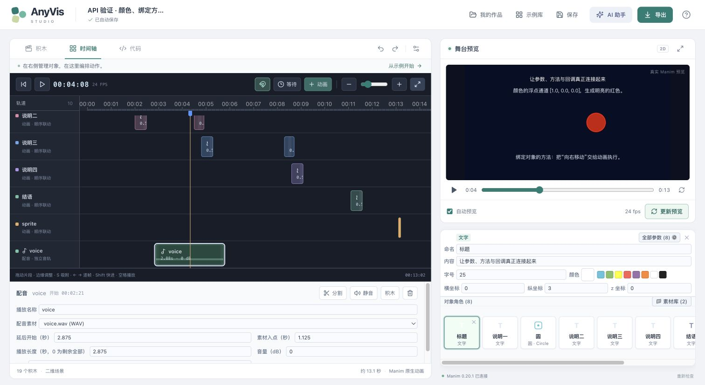
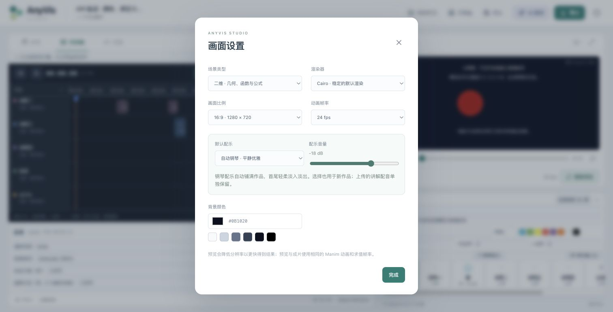
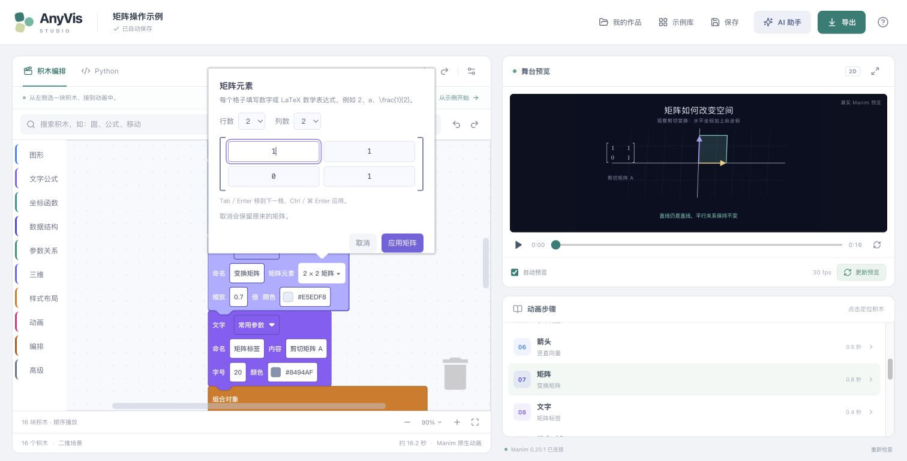
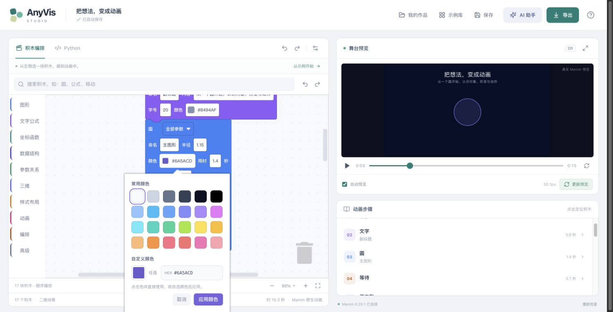
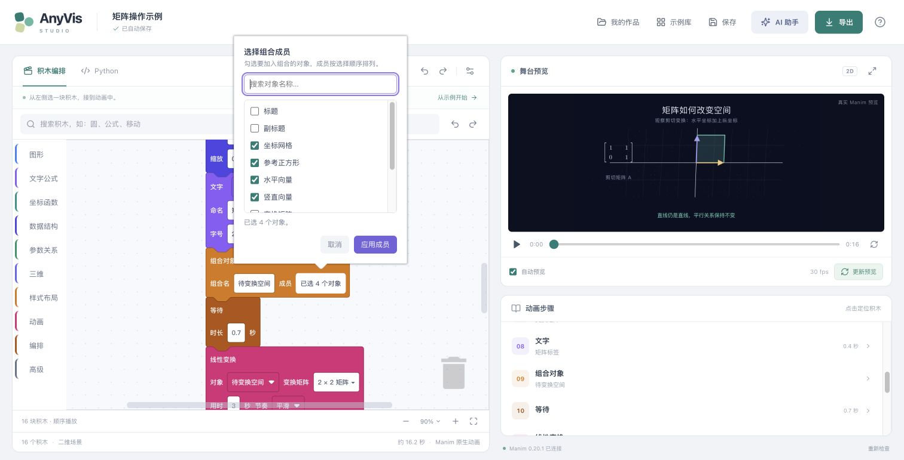
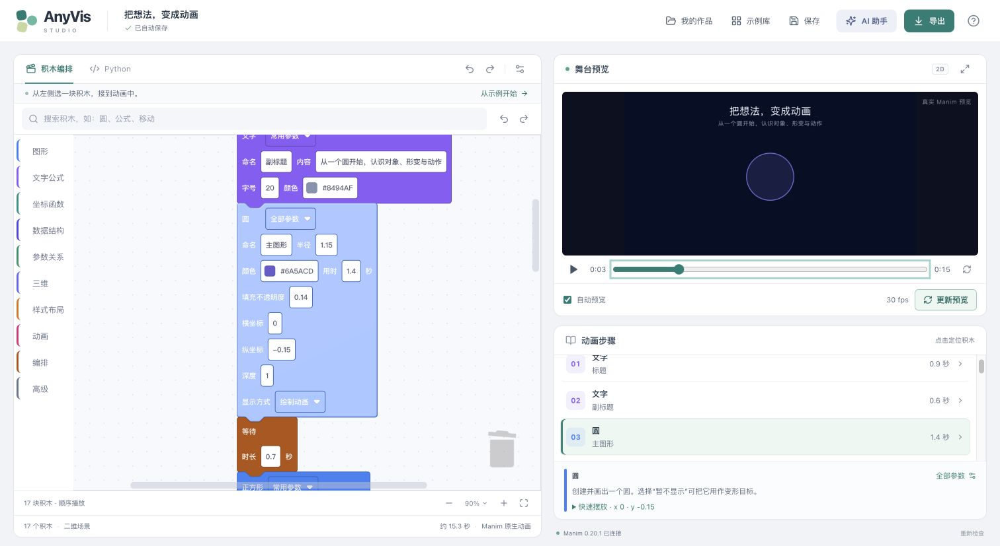
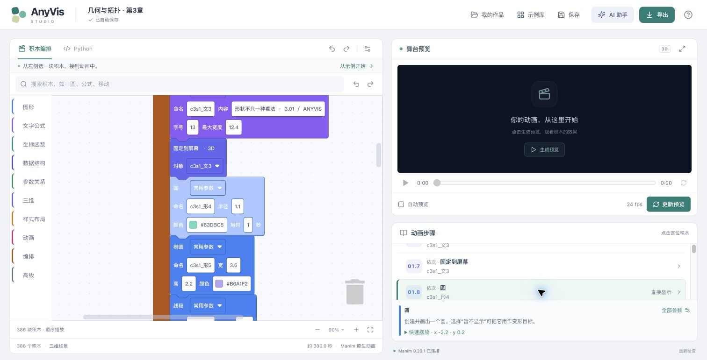

# AnyVis 验证记录

## 场景与坐标系验证、原生兼容修复（2026-11-08）

PR #1 已获用户授权并合并，提交 `4173c5fd06fb1669cd86bf0c1369fec49273dd0e`。本轮继续新增 55 个场景 API、49 个坐标系/曲线/图结构 API 和点云取样，十一份证据合并为 **935 / 2,293** 个独立入口，新增 105 项；仍有 1,358 项待验证，其中 533 项 OpenGL。

修复三处真实 Manim 0.20.1 行为问题：点云比例取样浮点索引错误、恢复三维默认视角时的属性错名、前景对象重复加入导致更新器双速。后者包括跨根分组与前景成员重叠，两种添加顺序均验证只更新一次并保留兄弟对象与前景层次。兼容处理仅作用于当前 Python 进程，独立源码导出也包含；版本门禁、能力探测、已有正确实现、子类重写、空集/越界及返回契约均有回归。

本地 342 项应用测试、20 项原生测试入口、6 项证据校验、11 项桌面检查、真实渲染/上传素材与混音、TypeScript/Vite 和桌面资源准备通过。完整云端结果与测试包以对应提交的 Actions 为准，下方下载保持已完成验证的版本。

## 图片 API 与复合片段删除修复（2026-11-08）

- 图片/相机新增 75 组具体断言，涉及 74 个 API；图片/相机阶段与既有证据合并后为 **732 / 2,293** 个独立 API，新增 70 项。继续加入 57 项动画和 41 项点云/向量场后，当前共 **830 / 2,293** 项，较上一轮新增 168 项，仍有 1,463 项待验证。
- 修复通过 API 创建 ImageMobject 时遗漏 Pillow 13 兼容初始化的问题。独立导出的纯 API 图片工程实际渲染，红色图片位移后像素重心落在预期区域；既有上传 PNG/SVG 与配音混音回归通过。
- 修复删除复合片段时漏检内部对象的外部引用。现在检查整个删除子树，阻止产生悬空引用；子树内部对象和引用可以一起删除。新增回归先复现旧实现失败，再验证修复。
- 本地 342 项应用测试、16 项原生测试入口（九份证据）、6 项证据验证、11 项桌面回归及 TypeScript/Vite 构建通过。应用修复提交 `04c5d206550cb2a476326096f990e12030a5f8d5` 的[原生 CI](https://github.com/zhuozheng2006/anyvis/actions/runs/42440905788)（732 项证据）与[三平台桌面 CI](https://github.com/zhuozheng2006/anyvis/actions/runs/42440905662)均通过。后续 830 项扩展只修改测试、证据校验和文档，集中在[已合并 PR #1](https://github.com/zhuozheng2006/anyvis/pull/1)；最终云端结果见 PR 检查页。

## v0.4.0 时间轴、对象与素材（2026-11-08）

采用 MIT 许可的 React Timeline Editor 1.0.0，替换手写拖拽时间轴。三个视图共享工程与撤销历史；新增对象管理、图片和配音上传、素材 ZIP、配音非阻塞调度与实际视频混音。[设计与边界](editor-timeline-design.md)。

| 检查 | 实际结果 |
| --- | --- |
| 前端、模型与编译器 | 340 项测试，39 个文件全部通过 |
| 真实 API 行为 | 六组原生测试合并去重为 662 项，0 失败；新增数值/回调/文件路径隔离 fixture 与变换/路径状态差分 |
| 入口与证据审计 | 2,293 项解析、2,117 项签名、2,765 项常量；证据源码指纹有效；4 项证据校验测试通过 |
| 服务与桌面宿主 | 6 项服务、11 项桌面检查通过；包含 3 MB 原始素材转发和普通 JSON 请求大小隔离 |
| 原生媒体集成 | 原有渲染/错误定位/取消链路通过；新增透明 PNG 位移和 OGG 配音延迟、入点、增益、停止验证通过，48 帧、水平移动 180 像素、有效片段 660 Hz、前后静音 |
| 浏览器 | 真实拖动配音 0→2 秒，左裁剪至开始 3.125 秒/入点 1.125 秒/长度 2.875 秒；音量 0→-6 dB 后撤销→0、重做→-6；积木参数同步；只读代码滚至末尾 |
| 素材可移植 | 浏览器下载 ZIP，检查项目 + 2 个原始素材 + Python 完整；重新导入后素材、参数和真实预览保留 |
| 构建 | TypeScript/Vite 与桌面资源准备通过；Studio 大分块警告仍存在 |

浏览器实测发现并修复了隐藏 Blockly 清空时间轴选择、拖动时检查器改变轨道高度、参数下拉 label/value 反转等问题。Gemini 3.8 Flash High 协作实现对象/素材管理与差分 fixture；集成后由主代理复核并测试。当前本机缺少已下载的 Electron 可执行文件，因此本轮本机未完成 Electron UI 冒烟，v0.4.0 配乐提交 `4c544f7` 的三平台 CI 均已完成，含最终 ASAR 启动；Intel Mac 仅构建、未实际运行。

协议升级为 authoringProtocol=4；启动器开发模式监视服务源码，新旧协议不符时提示重启。上传位图支持整体移动/缩放/旋转/透明度，角色的独立表情与肢体需要分层或矢量部件。

完整 API 行为覆盖仍未完成：1,631 项尚无逐项证据，包含 533 项 OpenGL 专属入口。已补充播放头处分割配音、一次撤销及 Home/End/Shift 逐帧定位；关键帧曲线、框选、动画剃刀工具与任意跨轨动画重叠仍需实现。

### v0.4.0 后续修复与独立 CI

默认配乐支持本地生成舒缓钢琴、无配乐及音量调节。新作品默认钢琴，偏好可记忆；已有/导入工程保留设置。时间轴显示自动铺满的配乐轨，画面设置与对象管理器均可进入。生成器的确定性、毫秒长度、峰值、首尾淡化及 600 秒上限通过；4 秒真实视频为 96 帧，云端钢琴音轨 RMS 0.01573、峰值 0.07453，关闭后无音频流。浏览器完成切换、真实预览、刷新后的设置恢复；独立 Python 导出包含合成器。

服务重启后的过期会话仅自动刷新重试一次；权限拒绝与不明确的网络错误不重试，三项回归通过。

配乐应用提交 `4c544f7c6fd7ea23d8d1ee9171542b5832c971c9` 的[独立原生 CI](https://github.com/zhuozheng2006/anyvis/actions/runs/42413639269)全部通过，包含 662 项 API 行为证据、真实配音分割混音、钢琴与无配乐视频及 600 秒合成检查。[原生验证附件](https://github.com/zhuozheng2006/anyvis/actions/runs/42413639269/artifacts/13590851025)。三平台桌面结果和安装包见下方最新下载。

- `021860b` 修复 SVG 小数 viewBox 被舍入为零，以及无 viewBox 的物理尺寸换算；真实视频逐帧检查蓝色 SVG 图形保留。
- 首轮原生 CI 在生成 OGG 测试样本时因 PyAV 不含 `libvorbis` 编码器失败。改用仓库内自生成的固定 OGG 样本后，[原生 CI 42411619514](https://github.com/zhuozheng2006/anyvis/actions/runs/42411619514)全部通过。仍实际上传、解码、裁剪和混音，不要求用户环境含 Vorbis 编码器。
- 时间轴新增配音分割，保留源素材连续入点与音量、独立命名，一次撤销还原。模型回归、浏览器操作与真实混音通过；分割点附近 RMS 0.0501，前后静音、有效片段 660 Hz。动态时机的配音显示在待编排列表；组合快捷键不再误触吸附，鼠标选择片段增加直接响应。

## v0.3.1 行为验证扩展（2026-11-08）

在 Manim CE 0.20.1 / Python 3.12 / Cairo 上，三组原生测试合并后取得 **419 个不同 API** 的行为证据；包括几何/变换/路径/颜色与速率/动画/三维坐标六个家族的 544 次断言调用，以及 199 个读接口与直接 Python 调用的差分检查。另 1 个 `NumberLine.get_labels` 默认实例直接调用就报错，明确保留为 fixture gap，不计覆盖。

修复 JSON 丢失 Python float 类型导致 RGB 的 1.0 变成 1/255、嵌套方法未调用子类重写、少字段积木隐藏必要输入的问题。新增绑定方法值及递归可视参数树。前后端统一检查 authoringProtocol=2，旧服务需重启。

17 块可编辑回归工程实际生成 13.17 秒、1280×720、24 fps 视频；316 帧全部解码，285 帧检出红色像素，时间戳单调。真实 worker 媒体/诊断/取消集成、6 项服务和 10 项桌面宿主/独立 bundle 检查通过。源码指纹让过期或失败的原生证据无法混入覆盖报告。

287 项 Vitest 测试、TypeScript/Vite 构建、桌面资源准备通过。Chrome 768×819 实测确认递归弹窗正文滚动、底部应用/取消按钮完整可见；非法 JSON 切换被阻止且草稿保留，Esc 关闭。嵌套回调应用后一步撤销/重做通过。Gemini 3.8 Flash High 协作修改 6 个 UI/测试文件；主代理根据实际浏览器结果与代码审查回修并全量复验。大分块构建警告仍存在。

依赖审计识别 mathjs 与 Vitest 链共 4 项告警；定向更新至 mathjs 15.2.0、Vitest 5.1.0 后为 0 项。其余直接依赖保持，未使用强制 audit fix 或跨版本传递依赖 override。升级后重新通过上述 287 项测试、原生测试、媒体集成和桌面构建；证据指纹现在也绑定 package-lock.json。

首次独立 Ubuntu CI 的 419 项原生行为通过，但完整入口审计因 OpenGL 窗口模块缺少显示服务失败。修复仅为审计命令提供 Xvfb，未删除任何失败条目；[修复后的原生 CI](https://github.com/zhuozheng2006/anyvis/actions/runs/42400588533)通过。Xvfb 导入检查不等于 OpenGL 真实渲染。

最终应用提交为 `1f28edc9f79c15f3ba37919e835eb4dac2c8ce10`。[最终独立原生 CI](https://github.com/zhuozheng2006/anyvis/actions/runs/42401140743)通过：依赖审计 0 项、2293 项入口全部解析、2117 项签名一致、419 项原生行为证据、真实媒体集成通过。[审计与行为证据附件](https://github.com/zhuozheng2006/anyvis/actions/runs/42401140743/artifacts/13585930255)。当前依赖版本的[三平台桌面 CI](https://github.com/zhuozheng2006/anyvis/actions/runs/42401140734)结果见文末；下方 v0.3.0 安装包只对应历史版本。完整 API 行为验收尚未完成，533 项 OpenGL 专属入口仍缺少可用本机渲染后端。

## v0.3.0 API 扩展（2026-11-07）

本轮新增基于真实签名生成的 API 积木库，固定 Manim CE **0.20.1**。共 **2293 个独立 API 入口、9136 个参数字段、2765 个常量**；原有 1660 项公开清单全部有对应入口。继承方法别名（例如 Axes.plot）、返回值、属性读写、可调用参数、上下文管理器均进入编译器。原有 97 种入门积木保留。

| 检查 | 实际结果 |
| --- | --- |
| 前端与编译器 | 252 项测试通过；包含全部 API 积木分批序列化往返、参数控件、引用重命名、回调作用域与权限传播 |
| 静态原生审计 | 2293 个入口、2765 个常量全部解析；2117 个可检查签名一致；5 个类无 Python 可检查签名，以 args/kwargs 接入 |
| 新增 API 原生行为 | 27 个不同 API 的真实 Manim 调用，检查几何状态、属性、更新器、动画组合、参数传递和上下文恢复；不等于逐项渲染验收 |
| 服务集成 | 项目→服务编译器→真实 Manim→可播放媒体，诊断与取消链路通过 |
| 可编辑演示 | 21 块工程生成约 23.54 秒、1280×720、24 fps 视频，565 帧全部解码；关键帧人工查看 |
| 浏览器 | API 搜索、圆积木添加、常用色板选色已实际操作；原工程另行保留 |
| 桌面 | 本地宿主/打包回归通过；本版本三平台 CI、最终 ASAR 启动与 API 搜索/添加通过，见文末下载与验证记录 |

示例：[参数改变整条曲线](../examples/api/README.md)。[完整审计报告与边界](Manim-API-Coverage.md)。

**尚未完成的验证**：533 个 OpenGL 专属入口仅完成描述与编译接入，本机 glcontext 缺少 EGL 后端，未通过 OpenGL 真实渲染；Manim 0.22.1 尚未安装验证；复杂嵌套回调仍需要结构化 JSON。CLI、文档构建、私有和运行时动态属性不计入公开创作 API 清单。不能把入口覆盖称为全部功能与全部参数组合已验收。

正在运行旧服务时，新前端会提示重启 `npm run studio`，避免把旧编译器不认识新积木的错误暴露给用户。桌面程序需要退出后打开新版。

## v0.2.2 历史记录

日期：2026-11-07。此记录区分已执行的测试、真实画面检查，以及仍受环境限制的验收。

## 本轮可运行实现

- 原生积木编译器与项目格式；97种目录入口，其中96种为非任意代码积木。
- 默认积木界面，真实Manim预览帧/视频，项目保存、导入导出、Python导出。
- 本地独立作业服务，取消、超时、错误定位、媒体Range、缓存。
- 七个原生积木模板与对应真实Manim预渲染视频；编辑后必须重新渲染，内置参考视频不充当新结果。
- AI兼容服务代理与结构化项目导入，未调用付费模型。
- 色板/任意颜色入口、类型过滤的对象下拉、组合成员多选、矩阵网格、多行代码、单位后缀、嵌套步骤与未连接积木提示。

## 已执行检查

| 检查 | 结果与实际范围 |
| --- | --- |
| `npm test` | 149项通过，包含编译边界、Blockly往返/撤销、AI校验、模板哈希、预览失效、导出、保存恢复、可视化字段、对象引用、500动作往返、批量SVG构造与组合移除回归 |
| `npm run build` | TypeScript与Vite生产构建通过；大分块警告仍存在，不等于性能达标 |
| server 单元检查 | 6项通过，含媒体Range、来源/Host/会话令牌、环境选择、生命周期清理和关闭时取消AI请求 |
| 桌面独立服务与宿主检查 | 10项通过；独立服务和界面资源准备成功；三平台真实Electron启动与安装包构建通过，见桌面打包记录 |
| 新增19种原生积木 | 两段真实视频共233帧全部解码，14项场景断言通过；不代表全部参数覆盖 |
| API覆盖清单 | 10项审计测试通过；固定Manim CE 0.20.1，1660项范围内API中96项有积木入口映射；完整清单可复现 |
| server 原生集成检查 | 1项完整真实链路通过：项目→编译器→Python→Manim→H.264媒体；另测2D/3D、中文/公式、错误积木定位、缓存、取消 |
| 七个完整模板 | 全部原生渲染并查看关键帧，详情见模板README |
| 77种非代码积木目录冒烟 | 实际运行最后帧模式通过；只证明接口可调用，不替代逐项动画视觉验收 |
| UI检查 | Chrome 中检查双栏及窄窗口布局、模板切换、视频播放、颜色弹窗、坐标系过滤；矩阵两个单元格一起修改，一步撤销恢复原值；2×2变换矩阵拒绝非数值并提示具体行列；组合成员搜索、勾选与一步撤销；点击嵌套步骤展开折叠的父积木；Python 页“全部参数”回到积木页；空白作品一键添加圆和移动并成功原生预览 |
| 浏览器网络端到端 | 用户正常终端启动 `npm run studio` 后，实际在 Chrome 修改颜色并生成/下载视频；960×540预览与1280×720成片均为H.264 / 30 fps / 462帧，全部帧解码通过；成片第90帧检出1062个接近新颜色 `#6A5ACD` 的像素（RGB各通道容差15），确认新参数进入真实输出 |

另用独立导出的Python文件运行真实CLI，不另传尺寸/fps参数，确认竖屏 **270×480 / 24 fps / 12帧**；源码导出保留项目画面配置。

截图中的底部状态为 Manim 0.20.1 已连接，舞台标记为真实 Manim 预览。原用户草稿保留在“我的作品”，操作验收使用另外创建的示例作品。

对象多选控件及对应测试由 Antigravity 中的 Gemini 3.8 Flash High 编写；集成审阅后回修了分隔符兼容性与搜索后的键盘焦点，再进行主编辑器验收。模型生成的代码没有跳过审阅与测试。

## 运行环境与明确边界

真实渲染基于当前已安装的Manim CE **0.20.1 / Python 3.12 / Cairo**。原生默认MP4所需libx264在此PyAV构建中缺失，本地服务已采用原生WebM再用已有libopenh264转MP4。该输出链实际生成并解码成功，但不同机器仍需环境检查。

设计的正式目标仍是Manim 0.22.1，未升级或修改用户conda环境。本机下载Electron受网络限制；GitHub CI已在三平台真实启动准备后的Electron应用并生成安装包。本机真实Manim渲染验收采用浏览器界面及相同编译器/worker。最终安装包在目标机器上的安装与渲染仍未完成。

自动化集成测试通过无socket适配调用同一个HTTP handler；Python、Manim和媒体均真实运行。它与上表单独执行的浏览器网络端到端验收是两项不同检查。工具沙箱仍不能新建监听端口，浏览器验收使用用户在正常终端启动的已有服务。

未宣称全Manim API覆盖、任意脚本即时跳转、时间轴回写、用户研究达标、Windows安装验收、直接API接入外部模型的端到端验收。Gemini应用另行生成影片工程，经过校验和修订，详见影片记录。代码扩展不算原生积木覆盖。

- [模板画面记录](../src/studio/templates/README.md)
- [核心项目协议](v0.2-project-format.md)
- [本地服务与测试](../server/README.md)
- [v0.1与P0历史记录](archive/v0.1-and-p0-verification.md)

## v0.2.2 界面改进

减少工具栏高度、提高次级文字对比度、扩大播放滑块命中区域、突出选中步骤和需要更新的预览。禁用容器中的对象不再被误认为可用引用，原引用保留并显示警告。

完整覆盖范围见 [Manim API清单](Manim-API-Coverage.md)。

## 长片生产中的回归验证

- 72个原生积木镜头共1800秒，六个可编辑章节各300秒；没有Python扩展积木。生成器编排AnyVis项目，编译器生成Manim代码。
- 完整影片43,200帧全部解码、时间戳单调，720p/24fps；逐镜检查关键帧并修订数学与画面对应关系。
- 文字最大宽度：真实Manim测量确认超宽文字缩小，短文字及位置保持。
- 强调效果：20组原生效果/节奏组合检查结束后的几何、颜色、不透明度与可见对象集合恢复。七个模板按新字段重新真实渲染。
- 长章节：386块工程在Chrome从文件选定到步骤可见566ms；默认命名段落折叠，点击内部圆积木可展开并定位。该单次实测不是跨设备性能保证。新增7项缓存、500动作往返、BlockSvg构造与保存状态回归。
- 服务关闭取消AI请求；桌面退出先关闭窗口触发保存，再等待引擎结束。

此图验证项目载入与编辑，舞台未生成预览；影片由相同编译器和worker的批量入口渲染，不能把截图中的空舞台描述为影片播放验收。

## 最新桌面测试包

**AnyVis v0.4.0**：[构建 42440905662](https://github.com/zhuozheng2006/anyvis/actions/runs/42440905662)，对应 `04c5d206550cb2a476326096f990e12030a5f8d5`，三平台构建与最终 ASAR 启动均通过。包含开源时间轴、对象管理器、图片与配音、SVG 尺寸修复、配音分割、默认钢琴与无配乐设置，服务重启后的会话恢复，以及本轮 API 图片渲染与复合片段删除修复。

| 系统 | 安装包附件 | 实际启动验证 |
| --- | --- | --- |
| Apple Silicon Mac | [ARM64 DMG 与 ZIP](https://github.com/zhuozheng2006/anyvis/actions/runs/42440905662/artifacts/13601577386) | 通过 |
| Intel Mac | [x64 DMG 与 ZIP](https://github.com/zhuozheng2006/anyvis/actions/runs/42440905662/artifacts/13601975289) | 仅构建，未在 Intel 运行 |
| Windows x64 | [NSIS 安装程序](https://github.com/zhuozheng2006/anyvis/actions/runs/42440905662/artifacts/13600689920) | 通过 |
| Linux x64 | [AppImage 与 DEB](https://github.com/zhuozheng2006/anyvis/actions/runs/42440905662/artifacts/13601124397) | 通过 |

每个平台执行 342 项应用测试、11 项桌面回归、准备目录和最终打包应用的 Electron 冒烟；实际操作 API Wait 搜索/添加、Circle 对象管理器、时间轴、只读代码，以及钢琴→无配乐→钢琴切换。附件保存 14 天（预计北京时间 2026-11-22 到期），需要 GitHub 登录。Python/Manim、字体和 LaTeX 仍需外部环境；macOS 尚未公证、Windows 尚未配置发行者签名，未运行安装向导。

## v0.3.1 历史桌面测试包

**AnyVis v0.3.1**：[最终构建 42401140734](https://github.com/zhuozheng2006/anyvis/actions/runs/42401140734)，对应应用与依赖提交 `1f28edc9f79c15f3ba37919e835eb4dac2c8ce10`。2026-11-08（北京时间）三平台全部成功。

| 系统 | 安装包附件 | 最终应用启动检查 |
| --- | --- | --- |
| Apple Silicon Mac | [ARM64 DMG 与 ZIP](https://github.com/zhuozheng2006/anyvis/actions/runs/42401140734/artifacts/13585751994) | ARM64 通过 |
| Intel Mac | [x64 DMG 与 ZIP](https://github.com/zhuozheng2006/anyvis/actions/runs/42401140734/artifacts/13586020317) | 已构建；未在 Intel 机器运行 |
| Windows x64 | [NSIS 安装程序](https://github.com/zhuozheng2006/anyvis/actions/runs/42401140734/artifacts/13584863724) | x64 通过 |
| Linux x64 | [AppImage 与 DEB](https://github.com/zhuozheng2006/anyvis/actions/runs/42401140734/artifacts/13585269190) | x64 通过 |

每个平台运行 287 项应用测试、10 项桌面回归、准备目录的 Electron 启动、安装包构建和最终 ASAR 应用启动；最后一项验证打包状态、外置 worker、API 搜索/添加、会话与固定协议、视频 Range/解码，以及引擎重启后的存储。检查报告：[Mac](https://github.com/zhuozheng2006/anyvis/actions/runs/42401140734/artifacts/13585458417)、[Windows](https://github.com/zhuozheng2006/anyvis/actions/runs/42401140734/artifacts/13585755880)、[Linux](https://github.com/zhuozheng2006/anyvis/actions/runs/42401140734/artifacts/13585348906)。

另有[独立 Manim CI](https://github.com/zhuozheng2006/anyvis/actions/runs/42401140743)真实执行 Cairo 渲染与媒体集成，不以桌面参考视频冒充 Manim 渲染。依赖审计为 0 项已知告警；这不是不存在任何安全问题的保证。

附件需要 GitHub 登录，于 **2026-11-22 02:27–02:30（北京时间）** 附近过期。Python/Manim、中文字体和 LaTeX 仍为外部依赖；macOS ad-hoc 签名且未公证，Windows 未配置发行者签名。未运行安装向导，也未在目标机器完整验收外部环境或 Intel Mac 启动。已运行旧服务时，请在原启动终端按 Ctrl+C 后重新运行 `npm run studio`；桌面版退出后使用新安装包。

## v0.3.0 历史桌面测试包

**AnyVis v0.3.0**：[构建42379483960](https://github.com/zhuozheng2006/anyvis/actions/runs/42379483960) 对应提交 `c31aa313aec4a505c639ec0077ac41f87360847b`。2026-11-07（北京时间）macOS、Windows、Linux 全部成功。

| 系统 | 安装包附件 | 最终应用启动检查 |
| --- | --- | --- |
| Apple Silicon Mac | [ARM64 DMG与ZIP](https://github.com/zhuozheng2006/anyvis/actions/runs/42379483960/artifacts/13576792694) | ARM64 通过 |
| Intel Mac | [x64 DMG与ZIP](https://github.com/zhuozheng2006/anyvis/actions/runs/42379483960/artifacts/13577086498) | 已构建；未在 Intel 机器运行 |
| Windows x64 | [NSIS安装程序](https://github.com/zhuozheng2006/anyvis/actions/runs/42379483960/artifacts/13576599871) | x64 通过 |
| Linux x64 | [AppImage与DEB](https://github.com/zhuozheng2006/anyvis/actions/runs/42379483960/artifacts/13577375301) | x64 通过 |

本版本每个平台都执行 252 项应用测试、10 项桌面回归、准备目录的真实 Electron 启动，以及安装包构建后 `release/` 中最终 ASAR 应用的启动。最后一项核对打包状态、`app.asar` 路径、外置 worker 文件，实际搜索 Circle 并加入积木，验证会话与协议转发、视频 Range/浏览器解码、引擎重启后存储。检查报告分别为 [Mac](https://github.com/zhuozheng2006/anyvis/actions/runs/42379483960/artifacts/13577260634)、[Windows](https://github.com/zhuozheng2006/anyvis/actions/runs/42379483960/artifacts/13577715260)、[Linux](https://github.com/zhuozheng2006/anyvis/actions/runs/42379483960/artifacts/13577185882)。

本轮发现并修复 macOS CI 的撤销测试竞态：原测试固定等待 15 ms，可能早于 Blockly 的动画帧事件派发。六组字段/引用测试改为等待动画帧与后续 timer，并用 40 ms 慢帧确认多行代码的一步撤销/重做。首轮失败没有被记为通过；以上附件均来自修复后的同一个提交。

下载需要 GitHub 登录，附件于 **2026-11-21 22:02–22:04（北京时间）** 附近过期。桌面程序自主启动本地引擎，不需额外 Node 服务；Python/Manim、中文字体和公式使用的 LaTeX 仍是外部依赖。macOS 使用 ad-hoc 签名、未公证，Windows 未配置发行者签名。CI 验证最终应用，但没有操作安装向导，也没有把内置参考视频播放冒充本机 Manim 渲染。目标机器安装与外部环境验收仍需完成，见[打包说明](../desktop/PACKAGING.md)。

旧版 v0.2.2 的[构建42337701921](https://github.com/zhuozheng2006/anyvis/actions/runs/42337701921)对应 `36f7359`，仅作为历史记录。
