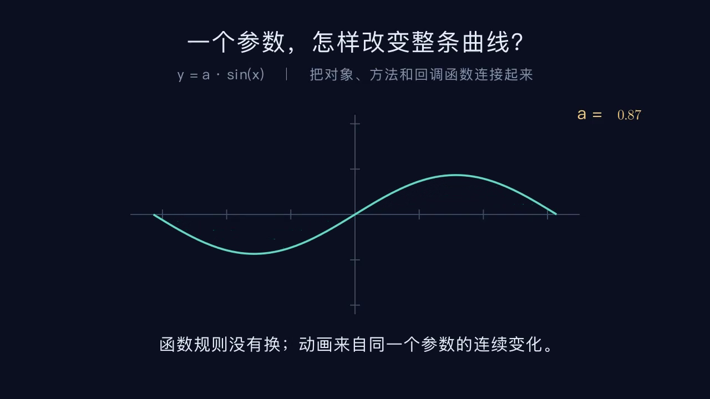

# API 积木示例：一个参数改变整条曲线

[打开可编辑工程](parameter-curve.anyvis.json) · [观看真实 Manim 视频](../../public/previews/api-parameter-curve.mp4)



21 个积木把 `always_redraw`、`CoordinateSystem.plot`、`Create` 和 `ValueTracker.set_value` 连起来。中文说明与坐标系使用常用积木，函数和方法使用 API 积木；没有 Python 扩展。改变参数 `a` 时，整条正弦曲线会在连续帧中更新。

在 AnyVis 中点击“我的作品 → 打开项目文件”，选择 `parameter-curve.anyvis.json`。API 参数可以通过弹窗编辑；复杂回调也保留为结构化数据，可继续让 AI 修改。

视频实际为 **1280×720 / 24 fps / 565 帧 / 23.54 秒**，所有帧解码通过。编辑器估算为 23.3 秒；各段动画按帧取整后会有小幅差异。该示例验证连续回调动画，不代表全 API 渲染验收。

重建工程与视频：

```sh
node scripts/make-api-tour.mjs
node scripts/render-projects.mjs --manifest examples/api/render-manifest.json --python /path/to/manim/python --output artifacts/api-tour --jobs 1
```

使用 Manim CE 0.20.1、Cairo，以及现有中文字体和公式工具。重新启动旧的 AnyVis 后端服务后再导入新版 API 积木工程。
